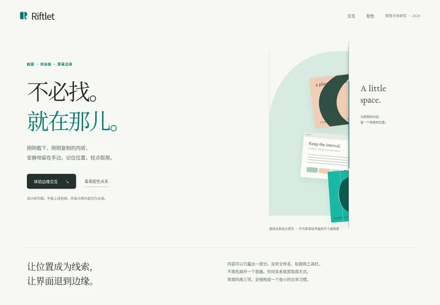

# Riftlet｜留在手边 · 视觉方向研究

**原稿日期：2026-10-26。状态：按用户要求归档的设计研究版本，不是最终批准的品牌、Logo、官网或产品界面。**

本目录保存用户在看到「青绿真正设计起来」这版完整视觉与交互样本之后，要求「把这一版写进 github 吧」所指的作品。它不是此前的六色对照页，也不替换 `round-01`、`round-02` 的空间设计研究。

## 查看作品

- **[完整 HTML 视觉与交互原稿](Riftlet_Art_Direction.html)**：下载该文件后直接用浏览器打开。HTML、CSS、SVG 与演示脚本均在一个文件内，不需要构建或服务端。
- **[静态预览](preview.webp)**：原 1440 × 1000 PNG 截图的 720 × 500 压缩浏览副本，不是重新设计或重新渲染的作品。用于仓库快速浏览；精细评价请看完整 HTML。
- **[来源与校验清单](manifest.json)**：记录源文件及仓库文件的大小、哈希和转换说明。

## 本版设计意图

核心优先级仍是：**空间记忆 ＞ 内容轮廓 ＞ 名称标签。** 品牌画面应有吸引力，实际使用界面应安静，两者不能混为同一个尺寸或装饰规范。

以「位置、遮挡、间隙与取用」建立 Riftlet 自己的视觉语言。内容仿佛藏在屏幕另一侧，只露出一部分；日常使用不依赖文件名、品牌名、大卡片或先悬停展开。Claude、mymind 是完成度参照，而不是可复制的风格模板。

本版主张保留青绿，通过近白、墨色、浅青与少量杏色形成完整关系，而不是仅给一个通用图标换色。大幅品牌画面的角度、图像尺寸和装饰性比例，**不能直接套用到常驻裂缝**。

## 原稿中的配色

| 角色 | 色值 | 原稿用途 |
| --- | --- | --- |
| 近白底色 | `#F7F8F4` | 大面积背景，不添加仿旧纸纹 |
| 墨色 | `#26312D` | 文字、结构、主要按钮 |
| 青绿主色 | `#19B7A4` | 图标与有限品牌色块 |
| 深青交互 | `#087C70` | 浅底文字、链接、焦点 |
| 浅青 | `#D6EBE1` | 有限面积的材质与层次 |
| 杏色 | `#F1CDB5` | 冷暖对照，不承担成功或错误状态 |

这些是本版的原始用色，不是强制全产品采用的最终色彩规范。实际内容不应被统一染成品牌色。

## 字体、图形与交互

字标使用本机 `Optima / Candara / Trebuchet MS` 等回退；展示英文使用 `Iowan Old Style / Baskerville / Palatino` 等回退；中文展示使用 `Songti SC / Noto Serif CJK SC` 等回退；功能文字使用系统无衬线字体栈。**未打包、复制或上传字体文件**，不同设备会存在字形差异。

当前间隙式 R 标记是形体研究，不是最终 Logo；还需要独特性、字标字距与小尺寸光学校正。本次归档不替换应用图标或任何现有正式资产。

离线演示保留三张合成截图、深浅背景切换、成功／明确失败／未知结果、连续点击排队和草稿文字保留。只有模拟 ready 后才完全吞噬；失败恢复；未知保留且不再次派发。指针停留在队列时不立即填补空位，离开后整理。

原稿使用 48 CSS px 最长边、29 CSS px 外露区及 35 × 48 CSS px 按钮区域，属于浏览器样本参数，**不是 macOS 逻辑点实机标定，也不是已批准的最终尺寸**。图片与附件状态全部合成，不读取真实系统截图或剪贴板，不连接 ChatGPT，不上传附件，不发送消息。

## 归档边界与验证

本次只保存已有作品和说明，没有重新设计页面，没有修改产品／技术基线，没有启动正式客户端或扩展开发，没有部署、发布、创建 CI、Issue 或 PR。

归档时核对了 HTML 内容、资源引用、重复元素 ID、内联 JavaScript 语法和 Git blob 哈希。没有重跑浏览器 GUI 测试，没有进行 macOS／Windows 真机测试、真实 ChatGPT 上传验证或用户测试。此前对离线演示的描述不构成真实上传链路的验证证据。

HTML 与对话原稿的唯一字节差异是去掉文件末尾一个 LF 换行；页面内容、CSS、SVG、脚本和交互保持不变。原稿页脚中「不改变现有仓库」是作品生成时的研究范围说明；本次用户另行授权的是归档，不能据此理解为正式开发或最终视觉批准。

## 原稿参考入口

- [Geist：Anthropic 设计案例](https://geist.co/work/anthropic)
- [mymind：设计原则](https://mymind.com/why)
- [mymind 官网](https://mymind.com/)
- [W3C：文本对比度说明](https://www.w3.org/WAI/WCAG22/Understanding/contrast-minimum.html)

以上保留为原稿的参考出处；本次归档没有重新进行品牌研究，也没有收入第三方 Logo、插画、字体或页面素材。
