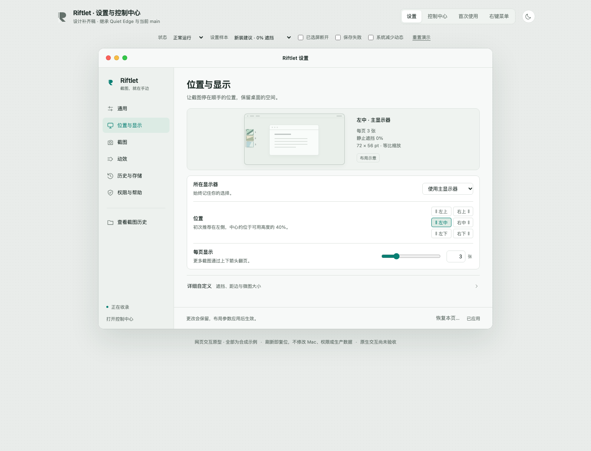

> **当前评审入口： [修正版 2 完整交互界面与交接](revision-2/README.md)** — X1–X13 已修复，原 82 项与补充 21 项全部通过。[直接打开新版 HTML](revision-2/Riftlet-Settings-Prototype.html)。以下内容保留为第一版验收记录；原型与失败证据未改写。

# Riftlet｜设置中心与菜单栏控制中心

2026-11-06｜最终评审候选 `settings-review-candidate-1`｜正式基线 `b61fc46cf931bdbd14deec1b47d077e92db61e16`

本轮直接继承设计分支 `design/settings-control-center-20261106` 的 `e1a7286d7eb14ff47686804718f61a2515a8fd12`，保留已有16文件中的原型、视觉与交互规范原件，只更新本README并补齐映射、实施交接、测试和证据。未修改Sources、正式main、已安装App或生产配置。早期恢复经过继续保存在RECOVERY，不能把它误解为本轮从零制作。

## 先看界面

[**直接打开完整交互原型**](Riftlet-Settings-Prototype.html)。这是已有、无外部依赖的单文件：下载或本地浏览器打开即可，刷新恢复样本；不需要运行构建器、安装Riftlet或连接ChatGPT。所有数据、权限、历史、错误和保存结果都是合成情境，不读取用户文件或真实聊天。GitHub的HTML源码页不执行交互，需要下载本文件后打开。

主视图可切换设置、菜单栏控制中心、首次使用及右键菜单。设置共六页：通用、位置与显示、截图、动效、历史与存储、权限与帮助。评审栏独立于产品窗口，提供明暗、四个主状态、推荐/当前/旧版设置和失败场景。

完整原型 SHA-256：`aded9ed13cd5ff54c0f0a2172bbe78c720c2f03f41f16ed11a864a09ef45fabf`（107129字节，与继承HEAD完全一致）。原型存在已确认交互差异，请同时阅读 [失败记录及实施裁定](FAILURES.md)，不能将它称为全绿或原生已实现。

| 六页设置（原始PNG） | 深色模式（原始PNG） |
| --- | --- |
| [通用](evidence/20261106-browser-02/screenshots/P1.png) | [通用·深色](evidence/20261106-browser-02/screenshots/D1.png) |
| [位置与显示](evidence/20261106-browser-02/screenshots/P2.png) | [位置与显示·深色](evidence/20261106-browser-02/screenshots/D2.png) |
| [截图](evidence/20261106-browser-02/screenshots/P3.png) | [截图·深色](evidence/20261106-browser-02/screenshots/D3.png) |
| [动效](evidence/20261106-browser-02/screenshots/P4.png) | [动效·深色](evidence/20261106-browser-02/screenshots/D4.png) |
| [历史与存储](evidence/20261106-browser-02/screenshots/P5.png) | [历史与存储·深色](evidence/20261106-browser-02/screenshots/D5.png) |
| [权限与帮助](evidence/20261106-browser-02/screenshots/P6.png) | [权限与帮助·深色](evidence/20261106-browser-02/screenshots/D6.png) |

控制中心：[正常](evidence/20261106-browser-02/screenshots/C1.png) · [暂停](evidence/20261106-browser-02/screenshots/C2.png) · [隐藏](evidence/20261106-browser-02/screenshots/C3.png) · [需要处理](evidence/20261106-browser-02/screenshots/C4.png) · [暂停且隐藏](evidence/20261106-browser-02/screenshots/C5.png)。

引导：[第1步](evidence/20261106-browser-02/screenshots/O1-step1.png) · [第2步](evidence/20261106-browser-02/screenshots/O2-step2-partial.png) · [第3步](evidence/20261106-browser-02/screenshots/O3-step3.png)。其他关键画面：[断开显示器](evidence/20261106-browser-02/screenshots/M1.png) · [重连待返回](evidence/20261106-browser-02/screenshots/M2-reconnected-awaiting-return.png) · [布局草稿](evidence/20261106-browser-02/screenshots/F4-draft.png) · [保存失败](evidence/20261106-browser-02/screenshots/S1.png) · [关闭确认](evidence/20261106-browser-02/screenshots/W1-close-confirmation.png)。

## 设计交付入口

| 文件 | 内容 |
| --- | --- |
| [恢复与缺口](RECOVERY.md) | 哪些直接恢复、哪些本轮补齐，以及无法恢复的原记录 |
| [源码快照](SOURCE-SNAPSHOT.json) | 正式main/tree、已读文件blob SHA与既有设计分支 |
| [菜单栏技术裁决](CONTROL-CENTER-DECISION.md) | NSMenu/NSPopover比较、选型理由与原生边界 |
| [完整交互规范](INTERACTION-SPEC.md) | 六页层级、状态、保存、迁移、多屏、引导、历史、文案 |
| [CONFIGURATION-MAP](CONFIGURATION-MAP.md) | 27字段与其他持久域的真实默认、范围、时机、兼容迁移及UI归属 |
| [IMPLEMENTATION-HANDOFF](IMPLEMENTATION-HANDOFF.md) | AppKit实施对象、命令与状态、保存/草稿语义、明确新偏好域、原生验收 |
| [TESTING](TESTING.md) / [测试脚本](tests/browser-regression.cjs) | 复现方法、环境、历史失败保留和验收边界 |
| [82项逐项结果](evidence/20261106-browser-02/RESULTS.md) / [JSON](evidence/20261106-browser-02/results.json) | 69 PASS、13 FAIL，不沿用遗失的旧PASS |
| [失败与实施裁定](FAILURES.md) | 必须避免照搬的原型行为，以及准确的后续实施合同 |
| [独立核查](DESIGN-REVIEW.md) | 非作者的源码映射、交接、浏览器证据与视觉检查 |
| [截图索引及哈希](evidence/20261106-browser-02/screenshots.json) | 50张未经编辑的原始PNG，覆盖页/主题/状态/失败 |
| [交付文件哈希](DELIVERY-MANIFEST.json) | 本轮文件身份、基线与禁止修改边界 |

## 需要保留的产品行为

日常操作仍是系统截图、点击边缘微图、附件进入当前聊天；不增加发送动作或新输入门槛。本专项仅设计控制表面和长期偏好，不修改既有附件输入、当前安装版或生产数据。

暂停收录与隐藏裂缝相互独立；空队列不留裂缝；清空可见队列保留文件、历史和已有聊天附件；减少动态只改变表现，不改变业务事件。几何旧值不因新版推荐而被覆盖。三个停止方向（暂停/隐藏/关闭内置截图）在写入失败时可能已停止当前运行，必须同时显示保存未确认，不把它们画成普通保存失败后的回滚；反向恢复失败不能假恢复。

所有有效个性化保留完整数值域；7个已失效字段保留兼容数据，而非提供假生效旋钮。原型中新增外观与登录启动能力保留为待实施设计，不能将内存模拟当系统已配置。存在文案或实现冲突时，以CONFIGURATION-MAP的main事实和IMPLEMENTATION-HANDOFF的细分规则为准；完整外观与页面结构继续继承HTML/TOKENS/INTERACTION-SPEC。

## 当前交付状态

**完整设计评审候选已交付；浏览器不是全绿。** 最新82项运行包含13条如实保留的失败断言，涵盖保存错误串扰、原意重试、源码兼容语义、焦点循环及归档首击。第一轮脚本问题与原型问题均保留，详见TESTING。无需用户重复截图或参与日志测试。

原生新界面实施与真实Mac原生交互：**NOT_RUN**。现有个人Beta的历史附件验收不替代新界面验收。本候选不合并main、不安装新App、不发布新二进制。
