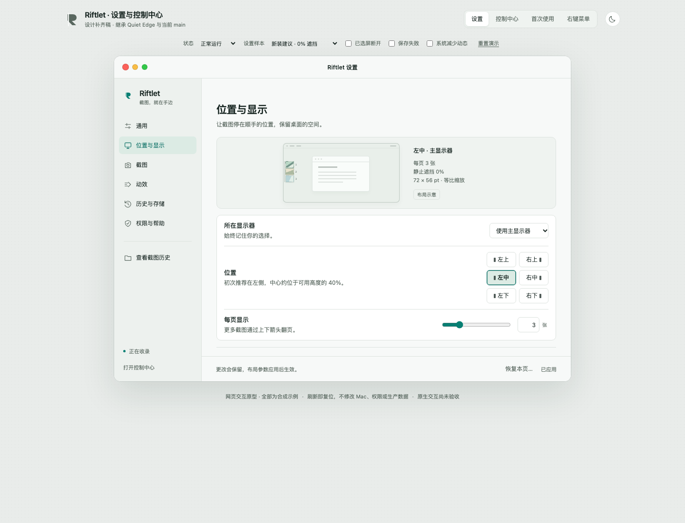

# 设置与控制中心 · 修正版 2

2026-11-06｜`settings-review-candidate-2`｜继承 `6372bcf3fbeb71cb7ad2d930cad18528e2d54796`，正式源码基线 b61fc46。

[**直接打开完整交互 HTML**](Riftlet-Settings-Prototype.html)。单文件、离线、无外部请求；所有权限、存储、截图和保存均为合成示例。六页设置、四种控制中心主状态、深色、三级自定义、显示器回退和三步引导完整保留。

**已无本次回归中的已知交互失败：82/82 + 21/21 PASS。** 这是可交最终视觉评审和后续 AppKit 实施的设计候选，不是新原生界面已发布。现有 App 和生产配置没有修改。

HTML SHA-256：`c58e4c7a3fa717a2fc5f68e8aaaf90e7950363a52c4047be182f9cb81fd67b58`（120030 字节）。

| 设置页面 | 浅色 | 深色 |
|---|---|---|
| 通用 | [P1](evidence/20261106-v2-browser-final/screenshots/P1.png) | [D1](evidence/20261106-v2-browser-final/screenshots/D1.png) |
| 位置与显示 | [P2](evidence/20261106-v2-browser-final/screenshots/P2.png) | [D2](evidence/20261106-v2-browser-final/screenshots/D2.png) |
| 截图 | [P3](evidence/20261106-v2-browser-final/screenshots/P3.png) | [D3](evidence/20261106-v2-browser-final/screenshots/D3.png) |
| 动效 | [P4](evidence/20261106-v2-browser-final/screenshots/P4.png) | [D4](evidence/20261106-v2-browser-final/screenshots/D4.png) |
| 历史与存储 | [P5](evidence/20261106-v2-browser-final/screenshots/P5.png) | [D5](evidence/20261106-v2-browser-final/screenshots/D5.png) |
| 权限与帮助 | [P6](evidence/20261106-v2-browser-final/screenshots/P6.png) | [D6](evidence/20261106-v2-browser-final/screenshots/D6.png) |

控制中心：[正常](evidence/20261106-v2-browser-final/screenshots/C1.png)、[暂停](evidence/20261106-v2-browser-final/screenshots/C2.png)、[隐藏](evidence/20261106-v2-browser-final/screenshots/C3.png)、[需处理](evidence/20261106-v2-browser-final/screenshots/C4.png)、[三个停止域错误并存](evidence/20261106-v2-visual-final/screenshots/light-three-stop-errors.png)。

细节：[布局精细](evidence/20261106-v2-visual-final/screenshots/light-display-fine.png)、[深色动效精细](evidence/20261106-v2-visual-final/screenshots/dark-motion-fine.png)、[保存失败](evidence/20261106-v2-visual-final/screenshots/light-layout-save-error.png)、[归档编辑](evidence/20261106-v2-visual-final/screenshots/dark-archive-editing.png)、[关闭确认](evidence/20261106-v2-visual-final/screenshots/dark-close-confirmation.png)。

## 实施与证据

- [27 字段及其他持久化域映射](../CONFIGURATION-MAP.md)：正式源码事实保持不变。
- [更新后的 AppKit 实施交接](IMPLEMENTATION-HANDOFF.md)：分域错误、明确意图重试、有效值/确认值、兼容数据、稳定编辑和原生验收。
- [X1–X13 修复闭环](FIXES.md)；[视觉调整与尺寸/对比](VISUAL-REFINEMENT.md)。
- [复验命令与边界](TESTING.md)、[原 82 项逐项结果](evidence/20261106-v2-browser-final/RESULTS.md)、[新增 21 项逐项结果](evidence/20261106-v2-editing-final/RESULTS.md)。
- [独立实现审查](DESIGN-REVIEW.md)、[交付文件哈希](DELIVERY-MANIFEST.json)。

旧版 HTML、69 PASS / 13 FAIL、原失败截图及规范均在上级目录保留；本目录还保留首轮迭代。视觉延续 Quiet Edge，只调整可读性、点击范围、焦点和滚动；未发现代表图中的明确裁切/不可读阻断。最终视觉喜好、原生字体度量、所有窗口尺寸和辅助技术需另行验收，不以截图宣称完成。
