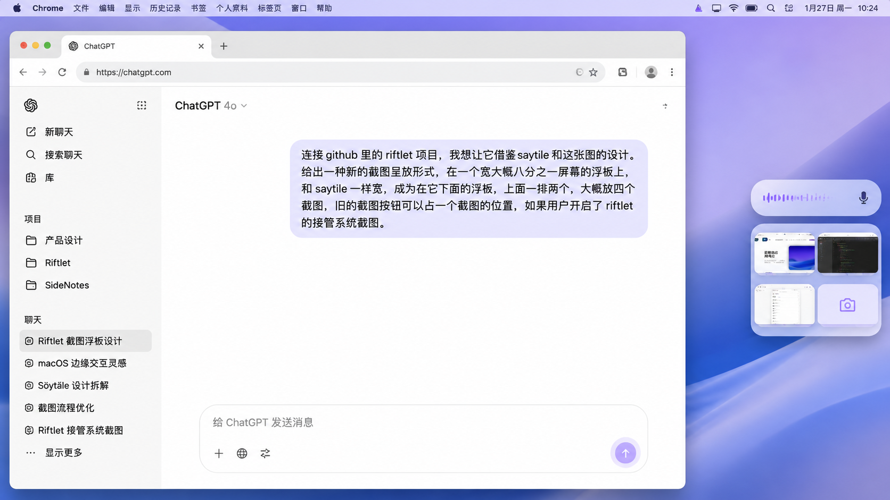

# Riftlet｜第三种呈放形式「截图托盘」——修订后的权威规格

> **2026-11-09 勘误版。** 本文取代本分支此前对单图展开、截图上移、菜单行数、相机入口和配色材质的错误描述。历史版本保存在 Git 提交记录中，不得再作为实现依据。
>
> 状态：**用户确认的产品决策 + 指定视觉基准**，不是“已原生实现”或“已视觉验收”。此形式与微缝、风铃并列；不允许为了实现第三种形式改变已有截图与附件生命周期。

## 0. 双重权威及优先级



- **视觉第一权威：上面的原始 1672 × 941 PNG。** 这是用户明确指定为“比后续设计图更好看”的一版。保留轻薄玻璃、紫蓝环境映射、内部间距、圆角比例、图片与按钮的视觉关系。禁止用后续错误生成图覆盖；Chrome、聊天文字、背景桌面只是演示场景。
- **行为第一权威：用户后来逐条确认的截图队列与展开状态。** 参考图为静态状态，不能据此发明它没有展示的展开行为。
- **发生冲突时：** 最新明确交互决定高于过往设计文档；已选原图的视觉观感高于笼统的“紫蓝”“八分之一”“高级”等形容词；对尚未验证的技术映射，明确标为待工程验证，不擅自补造行为。
- **实现边界：** Saytile 只是上方宽度/材质的视觉参考，不是安装依赖；只改界面呈放和对应设置，不改文件收录、原图、SQLite、队列 UUID、Chrome 目标、START/UNKNOWN、上传重试或自动发送行为。

## 1. 物理与视觉几何：固定宽度、固定槽位、最多两行

**“固定托盘大小”不是“无论 0–3 张都强制画一个两行高的大底板”。**

- 固定的是**托盘宽度、每个截图槽位的宽高、每行两列的几何**，以及最多两行的容量和裁切范围；不得随截图数量不断增宽、缩小单元格或新增第三行。
- **实际可见玻璃表面**可以是**一行高或两行高**两种离散状态。截图数量、菜单是否先打开、以及截图到达的事件历史共同决定当前状态；不能仅凭“现在有 1 张截图”推断一定是一行还是两行。
- 单行时玻璃表面只包裹一行，**不得绘制空白的第二行**。由一行变成两行时，新行从原托盘上方产生，原来底部行保持空间连续；回到一行则执行对应的补位。
- 双行视口始终 **2 列 × 2 行，最多四个常规项目可见**；单行最多两个位置。菜单展开时，一整行等价于两个截图槽位。
- 项目超出可见范围时应**完全裁切，不渲染第三行**，上下滚动查看。滚动时外框宽度、槽位尺寸不变；被裁切图片仍在队列和历史中。
- 截图本身、截图按钮、取消滑盖和展开四键要真实遵守槽位。**不能用一条比托盘更宽的横向条，不能在四键菜单的同一行硬塞截图。**

### 从用户原始图估算的视觉比例（用于还原，不是 macOS pt）

下面数值是原始 **1672 × 941 像素合成画面**中的近似包围盒，需按实际显示器逻辑点/缩放比换算，并在相同背景上做真实 WindowServer 对照。不是推导毛玻璃的物理透明度。

| 对象 | 图像像素（近似） | 几何意义 |
| --- | --- | --- |
| 上方 Saytile 胶囊 | x ≈ 1390–1632，宽 ≈ 242；高 ≈ 67 | 下方 Riftlet 托盘的宽度参照 |
| 双行截图托盘 | x ≈ 1390–1632，宽 ≈ 242；y ≈ 416–626，高 ≈ 210 | 参考图中的两行视觉包络，高宽比 ≈ 0.87 |
| 两浮板间距 | ≈ 14–16 | 保持两者独立、但属于同一侧边视觉系统 |
| 左右缩略图区域 | 每列约 110–114 宽；图内容约 75–80 高 | 图片不是可以无限扩张的卡片 |
| 托盘外轮廓圆角 | 约 20–24 | 相对柔和丰满，不能随意沿用通用小圆角 |

**重要的尺寸优先级：** 在这张参考图里，242/1672 ≈ **14.5%**，而“约屏幕八分之一”字面是 12.5%。后者只是用户的近似描述，**不能严格按 12.5% 计算，从而让实际视觉相对原图缩小约 14%**。优先复现已确认画面的实际比例及与上方胶囊同宽的关系；若 Saytile 未运行，从参考画面的比例建立独立响应式尺寸，不读取或依赖另一个 App 的进程。

## 2. 截图队列与按钮身份

- 用户可以设置呈放数量，默认目标为 **3 张真实截图**。单行/双行都受“最多两行四槽位”的物理视口约束；设置的截图容量与系统内部持久化队列不是一回事，超出可视数量时依靠滚轮查看，不删除截图。
- **截图按钮是一个特殊的截图队列项目，始终排在真实截图之后**，会随着截图到来而后移：无图第 1 位、1 图第 2 位、2 图第 3 位、3 图第 4 位。它不能固定在浮板角落，也不能变成独立的额外工具栏。
- 只有在用户启用相关截图入口时，按钮才应显示并占一格；关闭时不占格。**“接管系统截图”与源码里的“启用内置截图”不是已经证明等价的产品能力**：工程必须核对当前开关与实际接管范围，不能因为渲染按钮就宣称真正替代系统截图入口。
- 截图按钮可以随着队列继续增长而离开可见页，用户通过滚轮到达；不能为了让按钮常驻而破坏队列顺序。
- 现有截图生命周期、一次点击附加、开始接收后吞噬、失败/UNKNOWN 保护和历史行为保持不变。

## 3. 正常收起状态——原有队列位置（截图入口启用）

`A`、`B`、`C` 为按现有稳定队列顺序的截图；`K` 为占一个完整截图槽位的截图按钮；`·` 为空位（**不意味着需要绘制白色占位卡**）。

```text
0 张（一行）               1 张（一行）
┌─────────────┐          ┌─────────────┐
│ K       ·   │          │ A       K   │
└─────────────┘          └─────────────┘

2 张（两行）               3 张（两行）
┌─────────────┐          ┌─────────────┐
│ A       B   │          │ A       B   │
│ K       ·   │          │ C       K   │
└─────────────┘          └─────────────┘
```

超过四个队列项目继续保留在虚拟序列中；**视口只有四个可见格，鼠标滚轮上下滑动查看其他项目**，外框永不产生第三行。

## 4. 展开不是普通网格重排，而是会顶出截图的“独占一行”

`[M M]` 表示横向四键菜单，**在视觉上是一条宽度恰好等于托盘内宽的完整一行**，不是两个分别点击的截图格。默认截图方式始终在最右侧。

| 展开前截图数 | 按钮原位置 | 动作与方向（右侧托盘） | 展开后视觉状态 |
| ---: | --- | --- | --- |
| 0 | 第 1 格（左） | 从左格向右展开 | **仍一行**：整行菜单，没有截图 |
| 1 | 第 2 格（右） | 以右格为锚，向左展开，占掉第一格；已有 A 被**向上顶出视口** | **仍一行**：仅整行菜单；A 不可见但未丢失 |
| 2 | 第 3 格（下排左） | 从左向右展开，占下排整行 | **仍两行**：上排 A、B；下排菜单 |
| 3 | 第 4 格（下排右） | 从右向左展开，占下排整行；前面截图**依次向上移动一个队列位置** | **仍两行**：上排 B、C；下排菜单；A 被顶出视口 |

**3 张图展开时，必须是 B、C 留在上排、A 被顶出，而不是错误旧版文档中的“保留 A、B、隐藏 C”。** 这是滚动视口的内容位置转移，绝不重排内部真实队列。

在屏幕左边时可镜像**起始锚点及位移动画**，但必须让菜单仍占完整托盘内宽；默认截图方式在四键条中**保持最右**，不能因屏幕换边擅自反转用户的四个键顺序。

### 展开菜单和取消滑盖

- 截图按钮**不是在展开时消失，另起一套工具栏**；它要连续变形、移动，成为菜单中的默认截图方式及其**取消滑盖**入口。
- 原有选中/取消滑盖语义沿用 Riftlet 的真实截图控制逻辑。默认滑盖在用户设置的默认截图方式上，处于菜单**最右端**。不能简单用普通相机图标或无意义“更多”替代。
- 菜单共四个可见快捷位置：最右为默认截图方式，左侧三项为用户设定的常用截图操作。设置在 Riftlet 设置页，不在托盘里增加菜单/设置按钮。
- 只能映射现有已验证的截图操作；如果当前 ScreenshotMode 只有窗口/区域/全屏，第四个可配置常用操作的能力**尚未具备**，要作为工程缺口明确标识，不能把“更多选项”假装成用户配置的常用键。
- 展开时只显示一条菜单，不额外显示一个独立相机格、标题、计数、更多菜单或第五个控制。

## 5. 截图到达时存在**路径依赖**：不能只按当前截图张数算高度

同样是“队列里 1 张图、菜单展开”，用户明确描述过**两种不同历史**，实现不能把它们混为一谈。

**路径 A：先有 A，再点截图按钮展开。**

```text
折叠（一行）              展开（一行，A 上移出视口）        收起
[A][K]       ──────→      [ M M M M ]                ─→   [A][K]
```

- A 在展开前已经存在，因占行而被向上推走；**不准因此新增第二行**。
- 菜单收起时 A 沿原路径回到本来槽位，不突然换图或重排队列。

**路径 B：先没有截图，展开 K 后保持菜单，再通过它产生第一张新截图 A。**

```text
已展开（一行）             截图到达（两行；新行在上）          收起后（一行）
[ M M M M ]      ───→      [A][·]                    ──→     [A][K]
                            [ M M M M ]
```

- **新截图从菜单上方产生一行**，下方菜单保持展开；只是由一行切换到两行，永不产生第三行、也不增加浮板宽度。
- 收起时四键条归为一格，**上排新截图向下补位**，最终变成同一行的 A + K。按钮像一张截图一样参与补位。
- 若菜单已展开且有其他截图，新到截图仍要优先在上方截图行可见；该行已满时仅移动**视口窗口**以显示新图，旧图从上方裁切，不能修改真实队列顺序或产生第三行。滚动后可找回旧图。
- 捕获后菜单**不会自动收起**，除非用户执行了明确的收起/取消操作。不要把“截图完成”当作菜单关闭命令。

**禁止的错误算法：** 不能仅用 `rows = screenshotCount >= 2 ? 2 : 1` 计算所有状态；必须把 `captureMenuExpanded`、`newCaptureWhileExpanded`、`viewportOffset`、`captureSlotOrigin`、`existingAssetIDs` 等呈放状态作为布局输入，同时保证状态从一事件到下一事件连续。

## 6. 截图缩略图：长宽上限与遮挡含义

- 图片内容采用等比 Fit（保持完整原始宽高比），同时受截图微图的**最大宽度和最大高度**约束；原始图片很长时按高度缩小、很宽时按宽度缩小，另一维随之等比缩小。**不能 Fill 裁切或拉伸内容以填满槽位。**
- 令原图像素尺寸为 `(w,h)`，槽位内可用尺寸和用户最大尺寸综合成 `(W,H)` 逻辑点，则 `s = min(1, W/w, H/h)`，可见内容的尺寸为 `(w*s,h*s)`；像素与点的换算需根据实际显示缩放校准，不能拿 1672px 参考图直接当成 1672pt。
- **默认遮挡 0%**。用户在设置里改变遮挡量时，遮住的是**已经完成 Fit 的缩略图内容的一部分**，而不是重新缩放图片、删掉像素、改变图片原始宽高或改变托盘外框。遮挡仅改变可见裁切/层叠，不改变截图真实队列/UUID/可否上传。隐藏区域不应劫持其他图片的点击。
- 轻描边、圆角与内容清晰度遵循原视觉参考；被裁切的可见部分仍可按原图片身份点击并预览，必要时悬停预览仍使用完整图。

## 7. 颜色、玻璃、圆角：必须有可实施的视觉 token

**紫蓝玻璃是一种可选择且可以调节的视觉主题，不是固定把 `NSColor.systemPurple` 盖到不透明底板上。**

- 核心观感：**偏白、浅紫蓝环境映射、半透明玻璃**；柔和分层、适当背景模糊、亮部细边线、克制阴影。四个截图格要在同一个托盘材质系统中，不能各自呈现为生硬的白/黑大方块。
- 设置至少允许用户选择不同主题，且紫蓝色不能是唯一锁死的值；如果用户要求颜色**可调**，不能仅实现“系统 / 紫蓝”两个不可编辑的预设就声称符合要求。用户自定义色调/强度只能改变视觉层，不能影响截图图像本身。
- 明确分离 token：`trayGlassMaterial`、`trayTintColor`、`trayTintStrength`、`trayHighlight`、`trayHairline`、`trayShadow`、`trayCornerRadius`、`trayInnerPadding`、`trayColumnGap`、`trayRowGap`、`thumbnailMaxWidth`、`thumbnailMaxHeight`、`thumbnailCornerRadius`、`controlSurfaceColor`、`controlIconColor`。
- 这些 token 应从**相同背景与相同缩放条件下**的实际原生截图逐轮校准，不从参考合成像素颜色直接臆测毛玻璃的 alpha/blur 参数；RGB 只作为最终屏幕呈现目标，不能等同底层材料参数。
- macOS Light/Dark、Reduce Transparency、Increase Contrast、Retina/非 Retina 应采取同一布局关系和可读性规则。不可为高对比度方案偷偷改变排数、槽位数或按钮身份。

## 8. 必须覆盖的交互验收矩阵

| 输入场景 | 期望视觉和行为 |
| --- | --- |
| 0、1、2、3、4、10 张，菜单收起 | 0–1 单行、2+ 双行；最多四格，后续滚轮；按钮按队列末尾占位 |
| 0 张先展开 | 仍单行，整行四键 |
| 1 张已存在再展开 | 仍单行，A 被向上顶出；收起 A 回来 |
| 2 张再展开 | 上排 A、B；下排整行四键 |
| 3 张再展开 | 上排 B、C；A 从上方退出；下排整行四键；收起恢复 A、B / C、K |
| 0 张先展开、再截图 | 新截图在菜单**上方新增一行**；收起新截图**向下补位**到单行 |
| 菜单已展开、连续截图 | 菜单持续占一行，新截图优先可见，超过两图由视口裁切/滚轮恢复 |
| 左/右边缘 | 浮板不越屏；展开锚点镜像但四键语义次序不乱 |
| 竖图、超长/超宽图 | Fit、上下限、无遮拦时完整可见；遮挡设置生效但不更改原图 |
| Theme、窗口重启和用户设置持久化 | 紫蓝/其他主题可切，颜色强度可调；截图数量与遮挡值不丢失 |
| 一张图点击并触发 START/UNKNOWN | 命中 UUID 不变，正常吞噬/保留历史/失败恢复行为不回归 |

### 视觉验收不得和功能验收混为一谈

在**同尺寸、同类背景、同系统外观**制作参考图与 WindowServer 真截图的两列对照：
1. 先验证几何（真实图中浮板相对 Saytile 的宽度、单/双行高度、边缘距离、内边距、圆角及截图微图包络）；
2. 再验证材质（玻璃透色、层次、亮边、阴影、按钮和缩略图的融入感）；
3. 最后验证动画（菜单占行、截屏“上顶”、到达时新行上生、收起时回补、滚轮不出界）。
4. 把每项标成 `MATCH / MISMATCH / UNVERIFIED`，带真实截图和测量证据；没有真实原生截图不得自称“与参考图一致”。
5. 现有 51/51 GUI 或正式 CI PASS 仅证明对应测试项，**不能替代用户视觉确认**。

## 9. 本次勘误明确作废的旧表述

下面是此前我错误写过的内容，现在统一**作废**：

- ❌ “只要 1 张截图且菜单展开就变两行”；
- ❌ “3 张截图展开后保留 A、B、隐藏 C”；
- ❌ “截图到达就是改动永久队列首端顺序”；
- ❌ “所有截图数量共用固定两行高的大底板”；
- ❌ “单靠屏幕宽的 1/8 字面值就一定符合视觉参考”；
- ❌ “三个系统模式 + 更多 = 用户自定义四个常用截图键”；
- ❌ “紫蓝色主题 = 一块 systemIndigo / systemPurple 的半透明填充色”；
- ❌ “原生功能测试全通过 = 视觉一致性已通过”。

**工程交接：** 本文件是 PR #57 的修正输入。PR #57 需要逐项复核、提交最小必要源码修正、重新经过它的 G/H 评审、正式 CI 与真实 WindowServer 视觉对照；在视觉未确认前保持 Draft、不合并 main、不替换正式安装版。
