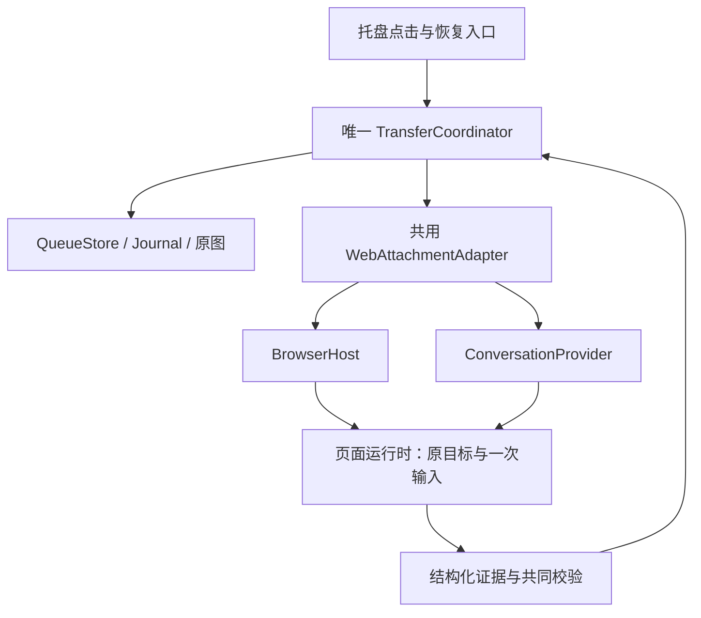

# 最终架构裁决与接口契约

设计规范，非已经实现的类型声明。接口命名可与最终 1.0.7 对齐；下面的身份、依赖和副作用边界不可丢失。依据见 [基线审查](BASELINE_AUDIT.md)、[浏览器研究](BROWSER_SPIKES.md)、[Provider 研究](PROVIDERS.md)。

## 1. 保留现有产品，只拆实际耦合

保留截图收录、托盘三形态、私有媒体、SQLite、journal、一次输入许可、`TransferCoordinator`、`ObservationNormalizer` / receipt policy、失败 aftercare 和 Sparkle。`WebAttachmentAdapter` 继续作为共用传输实现，逐步去除其中 ChatGPT/Chrome 的路由和 profile 硬编码。

不添加 Browser × Provider 专属 coordinator，不把新 Provider 伪装成 `chatgpt-web`，不建立第二份媒体库或另一套持久状态机。先用兼容包装保持最终 1.0.7 的 Chrome/Edge × ChatGPT 行为，再引入一个新 Provider 的完整链路。



现有 Swift package 可保持：纯值/状态在 `RiftletCore`；Host、Provider、页面资源及 Web transport 在 `RiftletAdapters`；App 是组合根；UI 只接收产品结果与恢复动作。Core 不导入 AppKit，不按浏览器品牌决定回执，不引用网站 selector。不为目录整齐增加 package 或插件系统。

## 2. 责任分界

| 边界 | 唯一责任 | 不允许承担的责任 |
|---|---|---|
| BrowserHost | 精确进程实例、前台窗口/标签原生定位、权限、脚本执行世界、执行/回执通道、原操作只读定位 | 识别网站附件成功、猜草稿、自动改投/激活另一标签 |
| ConversationProvider | 精确 origin/surface/route、唯一 composer、附件入口归属、事件配方、卡片身份、处理/失败语义 | 发 Apple Events、重试输入、直接清除托盘、读 cookie 或调用私有上传 API |
| PageRuntime | document/composer/draft epoch、单次 fence、字节缓冲、执行一种固定输入配方、受控观察 | 以通用 file input 或超时授予上传权限；全页图片计数即成功 |
| WebAttachmentAdapter | 校验原文件、分块传输、命令序列、结构化响应与来源校验 | 因丢回执换通道重传、根据 JSON 自行选择 Host/Provider |
| TransferCoordinator | 唯一用户意图、全局持久操作、一次输入许可、排队与恢复政策 | 保存 DOM 指针、维护网站 selector、让旧 UNKNOWN 重放 |
| QueueStore / journal | 原图及 operation 的崩溃一致记录、兼容迁移、nonce/状态与回执 | 把持久 token 当可重新获得输入权限的授权 |
| 产品 UI | 简短状态、保留图片、用户明确的新意图 | 暴露 transport/observer/超时设置或把失败交给用户逐项诊断 |

## 3. 身份与输入许可

目标至少包括：`hostID + bundleID + PID + processBirthToken + nativeWindowLocator + nativeTabLocator + providerID + providerRevision + origin + providerRouteIdentity + documentNonce + composerNonce + draftEpoch + clickBindingID + captureGeneration`。

- PID 或 URL 单独都不唯一。浏览器重启、窗口/标签号复用不能继承旧写权限。
- `nativeTabLocator` 是 Host 的 opaque 值；不能强迫 Safari 拥有 Chromium 的数字 tab ID，不能把当前 tab 的索引当永久身份。
- URL 的 query/fragment 是否影响对话由 Provider 决定。现有 ChatGPT 的移除规则不得全局复用。origin 必须精确 HTTPS、无 userinfo、无非许可端口；不以字符串 contains 匹配域名。
- `draftEpoch` 代表逻辑草稿，不以正在变化的输入文字作为 identity。用户继续输入不应平白阻止附加；新对话、编辑历史消息、切模式/账号/项目等必须按已验证规则失效或演进。
- DOM 被重建不自动等同原草稿。允许连续性必须由 Provider 提供经负例验证的证明；仅同 URL、同文字或同位置不足。必要时安全取消本次，保留图。
- 不承诺不存在跨进程竞态的“原子截图”。目标由点击边界绑定、进程/原生定位、页面 epoch、最终写前守卫共同约束；测试必须注入延迟与同 URL 导航/ABA。不能证明原目标时不输入。

点击边界先固定进程/窗口/标签和 Provider 路由，及时送出**轻量原编辑器绑定命令**；大脚本安装、图片读取/分块、观察等待放到异步执行。必须继承最终 1.0.7 的轻量绑定修正，不能照已审 build 45 把约 100 KB 程序和回执等待放在主线程。后台缓存只加速，不是第一次点击必须存在的授权条件。

**冷首次绑定不得自证身份。** 特别是 Safari 的索引 locator：必须先证明原生对象可稳定绑定，或存在点击前与该原生目标可靠关联的 witness。若首次异步 pin 只是向后来索引上的页面生成 nonce，其后的 nonce 匹配不能倒推证明它是点击时的页面。在首次 nonce 建立前注入同 URL 标签重排、延迟和 A→B→A，必须停止或仍命中原目标。无法建立此证明则该 Host 的冷首次绑定 `BLOCKED_TECHNICAL`；继续研究可证替代，不能把强制预热或再点一次冒充正常一次点击完成。

传输中的前台变化不改投。输入前最终校验失败则证明零输入并结束；输入可能已发生后，只允许观察原 operation。用户之后可以明确请求“查看原对话”，此动作经原身份核验后才激活窗口；自动观察不抢焦点。

## 4. Swift 接口草案

这些是评审接口，不作为可编译实现或测试通过证据。最终类型应尽量复用 `TargetLease` / `ObservationIdentity` / `TransferRequest`。

```swift
// Pure values live in Core. Opaque locators are host-specific, versioned data.
struct HostSession: Codable, Hashable, Sendable {
    let hostID: String
    let bundleID: String
    let pid: Int32
    let processBirth: String
}

struct ProviderBinding: Codable, Hashable, Sendable {
    let providerID: String
    let revision: Int
    let surfaceID: String
    let routeIdentity: String
    let documentNonce: UUID
    let composerNonce: UUID
    let draftEpoch: UUID
}

// ProviderRouter chooses from packaged manifests using a native-observed URL.
// It does not trust the providerID returned by an arbitrary page.
protocol ConversationProvider: Sendable {
    var descriptor: ProviderDescriptor { get }
    func classify(_ route: NativePageRoute) -> SurfaceMatch
    func program(for capabilities: BrowserCapabilities) throws -> ProviderProgram
}

@MainActor protocol BrowserHost: AnyObject {
    var descriptor: BrowserDescriptor { get }
    func permissionState() -> HostPermissionState
    func freezeClick() throws -> FrozenBrowserClick
    // Submit a bounded, lightweight pin at the same click boundary.
    // PendingBinding contains the frozen native snapshot and its one reply task.
    func bindAtClick(_ click: FrozenBrowserClick,
                     provider: ProviderDescriptor) throws -> PendingBinding
    func execute(_ command: BoundWebCommand) async throws -> BoundedReply
    func observeOriginal(_ request: OriginalObservation) async throws -> BoundedReply
    func focusOriginal(_ target: TargetLease) async -> Bool // explicit UI only
}

protocol AttachmentAdapterResolver: Sendable {
    func adapter(for target: TargetLease) throws -> any IndependentFileInputAdapter
    func reader(for operation: TransferOperation) throws -> any OriginalOperationReader
}
```

`FrozenBrowserClick` 只读；包含捕获代次、系统单调时钟和 Host opaque 原生定位，不能稍后替换为另一个前台。`BoundWebCommand` 绑定 target、provider/source revision、operation、attempt、invocation、asset hash 和副作用等级。`execute` 不公开“任意脚本”能力给 UI。

集成人对 `TransferCoordinator.select` / `recheckOriginal` 做最小 resolver 改造，取代单一 `adapter.id` 等号判断。每个 operation 持久绑定实际 adapter/provider；无匹配即只读不可用，不能退回当前默认 Provider。所有 Provider 共用一个 coordinator/store 与一次输入许可。

`BrowserCapabilities` 至少记录：实际执行世界、Promise 回执策略、原生 tab 定位策略、Navigation API 或安全替代 epoch 策略、File/DataTransfer/setter 能力、受限脚本字节预算。能力探测只读且不请求网站上传；不能用“Chromium”品牌假定 Edge/Brave 世界一致。

## 5. 页面协议与单次副作用

保留已验证的 `capture/pin → validate → begin → chunk → commit → observe/discard` 结构。拆出共用协议版本、身份校验、字节缓存、fence、受限观察队列；Provider 提供有限的 `probeComposer / resolveOwnedInput / inputRecipe / collectEvidence`。

1. **Prepare**：验证原目标、当前图片的媒体身份、服务实际能力、图片限制和现有附件；注册有限观察器并冻结输入配方。无法证明入口属于原 composer 则结束，不能遍历多个 input 试运气。
2. **Durable intent**：沿用现有 SQLite/journal 顺序，在任何可能有副作用的 native dispatch 前记录 `dispatchIntent/mutationPossible`。崩溃窗口宁可留下未知，也不重复输入。
3. **Stage**：校验每块索引、大小及总长度；只向已锁定页面运行时传字节。`begin/chunk` 不触发上传。丢失 staging 回执不自动重新发 commit。
4. **Commit once**：页面单线程内先置 committed fence，再最终检查原 document/composer/route、draftEpoch、surface/mode fingerprint、当前图片上传能力及输入归属，执行已冻结的配方。staging 期间同 URL 切模式也必须失效，除非有已认证的同草稿连续性规则；不能自动切回模式。原生 nonce 与页面 fence 双重防重入。
5. **Observe only**：native 返回丢失、AE 超时、进程取消或网站没显示卡片，均不换 paste/drop/selector/浏览器重发。恢复只读原 identity。`discard` 只释放本操作未交出的字节，不删除网页附件。

当前 ChatGPT 使用 setter + `input` + `change`，可按已验收配方保留。新 Provider 必须验证它自己的事件配方；两个事件可能被网站各处理一次。**setter 只有一次并不能证明网站只添了一张图。** 测试同时计输入次数、事件次数和最终原草稿附件数量。

直接 File/DataTransfer 输入是首选路径：不碰剪贴板、不要求本地路径暴露、不读取登录凭证。菜单/动态 input 发现只允许经过验证的本 composer 入口；picker hook 必须限定操作、互斥并在所有退出路径恢复原 descriptor。不调用未经验证的站内私有 API。

每个草稿的有副作用发现/写入段串行；不同点击有独立 operation，不能靠单一全局 busy 丢第二张图。只读观察走独立通道，旧 UNKNOWN 不阻塞新截图。队列等待后重新验证原目标；不会把排队的图送到后来窗口。

同一托盘项尚在输入/结果未明时的连击不得静默创建第二次输入；不同截图各自排队，不以全局图片hash去重。前次结束后用户明确“再次附加”才创建该图的新operation。两张内容相同但具有不同截图身份的图仍可分别附加。

## 6. 证据与消费级反馈

保留既有状态存储，不扩造第二套事务引擎。新语义按以下独立事实映射到现有状态/回执字段，必要时做可回滚的增量 schema 迁移。

| 事实 | 证据要求 | 用户结果 |
|---|---|---|
| 未输入失败 | 明确没有进入副作用边界/受认证零输入退休 | 图片保持可用，简短说明 |
| 输入可能发生、接受未明 | 已有 durable intent，回执不足 | 不自动重传；保留图与“查看原对话”入口 |
| 正面 START / acceptedIntoOriginalDraft | 原目标 + 本次图片 + 新附件成员 + 本 Provider 已认证接收证据 | 快速收起；“已交给 Claude”等；不写“上传完成” |
| providerReady | 本附件独立的处理完成/可用状态 | 可记录后台状态，不把发送按钮启用视为单图完成 |
| 明确后续失败 | 同一原附件、明确错误、连续身份 | 同图可见恢复，用户自行决定再次附加；绝不自动重传 |
| 用户移除/发送/身份失效 | 与服务失败不同；不确定就未知 | 不把网页删卡当作上传失败，不自动再塞回 |

接受证据同时具备：操作/图片关联、原 composer 成员归属、可见且语义正确的附件卡/进度、排除输入前已有卡及邻卡/嵌套卡。延迟、spinner、文件名、图片数量增加、无错误都不能单独授权收起。

优先保留原图字节/精确像素证明；站点缩放/压缩时可使用经独立负例验证的 **File 对象 → 网站附件标识 → 原卡片** 关联。不得降低为感知相似图或同文件名就 PASS。原始 PNG 的 SHA 和缩略图像素是不同对象；测试应使用独立 oracle，不以产品自己的回执自证成功。

网页替换附件卡可由 Provider 的严格关联规则接续；记录输入前基线、单调事件序号及有限观察环，防止轮询错过短暂 START。默认观察限定 composer/已确认 portal，限制内存/次数/时长；无无限全页扫描。停止观察不等于失败或完成。

## 7. 原文、选区、旧附件

正常路径不 focus、不改 textarea/contenteditable、不发键盘输入、不点发送。选区仅在必要的菜单操作改变它、原节点仍在且用户文字/选区 revision 未变时最小恢复。用户在异步上传期间输入的新文字、IME composition 或新选区优先，不能用旧快照回写。不因恢复文案丢掉富文本格式。

已有附件只用于基线与保留校验，不把旧 `FileList` 重新拼接后上传；input 暂存内容与已上传卡片不是同一库存。原数据不变是验收结果，不由 selector “看起来对”代替验证。

## 8. 持久化、升级与旧操作

- 保留既有 media、assetID、hash、operationID、attempt、nonce、START/UNKNOWN 及用户处置记录；不重置 SQLite，不重新导入全部历史。
- 原件 SHA 与实际传输 payload SHA/MIME/bytes 分别记录。PNG/JPEG 优先原样；必要转码记录确定性 rendition 版本，原件不变，不静默降画质。不能拿已转换 payload 与原件 hash 直接比较并宣称原字节相同。
- 新操作增加可选、版本化的 host/provider/source/route/epoch 信息；老记录按旧 `chatgpt-web` 与 legacy profile 解码，保持原样只读。新 Provider 不能从旧未知记录获得写许可。
- app 重启可凭匹配进程出生身份与仍存活页面 operation 续查；浏览器重启或页面 registry 丢失后无法证明原卡即 observation unavailable。不能凭历史 URL 重建一次上传。
- provider 升级后的新操作用新 revision；旧操作的解释使用其原 profile 或显式兼容只读 reader。不能以最新 selector 重新判定历史成功/失败而授予重试。
- 私密草稿 URL、选区文字、cookie、页面全文不写普通日志/公开 GitHub；必要 route 信息在本机最小保存，诊断使用本机盐化摘要。新草稿使用随机本地 nonce，不能把 URL hash 当身份真相。
- 当用户明确再次附加，创建新 operation 并重新绑定**当次**前台；旧操作保留。对输入未明的图，用户需先看到“可能已添加”，由明确动作表达再次附加意图；不每次普通点击都弹确认。

## 9. 兼容性隔离

Provider manifest 由签名 App 打包，含精确 origin、surface、版本化输入/证据 profile 和实际资源SHA-256；新operation绑定provider revision及resource digest，不能以同名sourceID推定同字节。已审49与45沿用v30名称却有实际代码增量，本轮以Git SHA区分；历史记录无digest则保留legacy状态，不猜填hash、不升级其回执权限。允许运行时按能力拒绝单个 Host × Provider × surface；不得通过远端脚本热更新降低证据要求。页面更新导致能力探测失败时保持原图，只影响该范围；其他 Provider 继续工作。

不要为了支持 Safari 改弱所有 Host 的 document 证明。**首个 Safari 实施能力门槛定为 Safari 26.2+、官方支持的 macOS 及运行时必要能力通过**：Apple / WebKit 记录 Navigation API 于 26.2 加入，而当前 pin 直接依赖它。Riftlet App 的 macOS 13 最低要求保持不变，不能据此宣称 macOS 13 上的 Safari 可用。旧 Safari 安全 epoch 替代在本周期做有边界验证；未通过就如实保持更窄范围。版本达标仍不等于产品已通过，不能用 WebKit 测试补签真实 Safari。来源见 [BROWSER_SPIKES.md](BROWSER_SPIKES.md)。

## 10. 首次授权与错误体验

| 场景 | 产品动作 |
|---|---|
| 首次在某浏览器点击 | 只解释并请求该浏览器的 Automation 权限；必要时一次 JS 开关指引；不预先要求四个浏览器全部设置 |
| JS 开关关闭 / TCC 拒绝 | 图片保留；一处“完成连接”入口，区分确切浏览器；不循环弹窗，不自动更改安全设置 |
| 完成权限设置 | 重新检查连接，原截图仍可见；因焦点/原目标可能改变，不自动重放旧点击 |
| 不是支持的 AI 页面 | “请打开支持的 AI 对话后再点图片”；不切换用户浏览器或打开新聊天 |
| 未登录 / 套餐限制 / 当前模式无图输入 | 简短准确说明，不偷偷换账号、模式、付费订阅或尝试其他输入 |
| 明确失败 | 图恢复；提供自然的再次附加动作 |
| 接受未明 | “暂时无法确认是否已添加”；可查看原对话和保留/找回图片；不制造自动重试按钮 |

设置只在现有“帮助/连接”下显示已安装浏览器的连接状态与修复入口。普通用户无需选择 transport、Provider、轮询时间或安全等级。辅助功能权限仅在经认可的可选 AX 路径确实需要时出现，不为四个默认 Host 提前申请；现有截图目录权限保持原流程。

## 11. 迁移顺序

1. 接续最终 1.0.7；冻结现有真实与受控证据，先保留旧行为。
2. 集成人用 compatibility wrapper 抽出 Host/Provider/Resolver，不顺手清空旧 observer。
3. Chrome × 一个新 Provider 完整通过目标绑定、一次输入、接受、失败、重启恢复；以此校准契约。
4. Safari/Brave Host 与其他 Provider/QA 同时实现；本轮开始即安排 Safari 验证，不留到最后。
5. 逐组合验证，修复具体缺陷；未通过组合不入默认支持清单。
6. 在同一个最终包完成真实矩阵与升级/发行验收；独立复核后再按现有授权交付。

路径、工作包与退出条件见 [WORK_PACKAGES.md](WORK_PACKAGES.md)。
