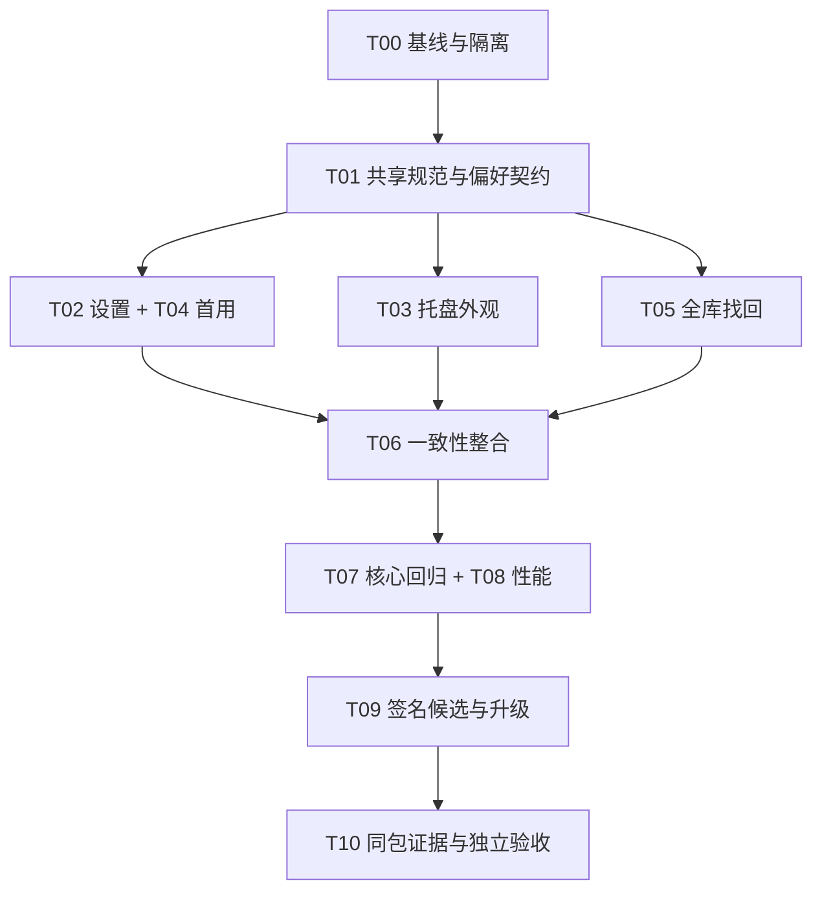

# Riftlet 1.0.4 Codex实施任务与依赖

本计划执行基线B=`3f8149e2313fd81bbaee5a7bbbdbb1efca2fc81b`，由本次规划分支带入已审文档后在独立1.0.4分支推进。设计不再开放式发散；遵循[DESIGN_SPEC](DESIGN_SPEC.md)、[设置台账](SETTINGS_INVENTORY.md)与[验收矩阵](ACCEPTANCE.md)。总任务[#106](https://github.com/haohongfei2001-png/Riftlet/issues/106)。当前状态：所有应用实施任务**NOT_STARTED**；本规划已做的1.0.3审计不算1.0.4实现。

## 依赖、分包与并行责任

图表示完成门，非要求晚做风险验证：T00即先复现红关闭和命中FAIL、记录核心基线；T07受控反例随改动运行，T08可提前测基线。T10视觉检查贯穿每包，最终同包复核在T09后。托盘共享renderer接口可在T01确定后与设置并行；Main/持久化接线由集成者统一，避免两个分支同时修改owner。

| 建议工程PR | 内容 | 结束时必须可独立复核 |
|---|---|---|
| A | T01 + T02，T04关闭语义与首用精简 | 原生四页、迁移反例、首用普通重启、真实浅深截图 |
| B | T03 | 分层透明度/机身色、真实像素mask、原托盘交互、命中FAIL闭环 |
| C | T05 + T06 | 全库查询与恢复、跨页/乱序反例、全局文案/错误一致 |
| D | T07 + T08实测必要修复 | 精确目标/一次输入回归、真实快双图候选、字节规模和soak报告 |
| E | T09 + T10 | 最终签名公证RC、24/25升级、同包native/real-service复核、独立review |

允许合并强耦合PR或将E的纯证据更新分开；不把不能运行的半套设置/渲染器分别宣称完成。每PR都需B→G→H及既有五项检查，不减门。已验证工作包可在独立开发/集成分支内正常合并，持续推进RC，不为每个内部合并停下来询问；合入main须另有授权并采用标准双父merge，本计划不授权公开发行。

## T00 基线、隔离与入口（P0）

**问题/位置：** AGENTS及旧quality入口仍指PR101；公开1.0.3 ZIP、main和stable feed不是同一版本状态；本轮桌面报告存在FAIL而wrapper退出0。参考[BASELINE](BASELINE.md)、`AGENTS.md`、`docs/MAINLINE_GOVERNANCE.md`、`scripts/run-settings-review.sh`。

**目标：** 每次工作使用明确源/包/环境，不打扰1.0.3发行、个人数据或正在审核的DMG。由集成者建立`dev/1.0.4-consumer`或等价独立分支，从B导入本规划PR；如果main前进，先记录完整delta并重新确认准入B，不能静默换基线。PR100/69/77不作为起点。

**任务：** 读BASELINE及现有配置；保留公有ZIP/hash；隔离profile和synthetic fixture；一开始记录普通首用红关闭/Cmd-W与相机命中失败的可复现环境；建立候选证据目录和case记录，任何runner最终解析report.status/每个case，不能只看退出码。沿用一个当前任务队列，将已实施旧Issue标作回归/证据补齐，不重新做其历史方案。

**完成：** 源/包/branch和冻结清单可复查，个人App/库未动；T01前能定位旧值/坏文件/新profile fixture；失败初始记录存在。#83保护未开启记录独立阻塞，不伪造GitHub approval或通过调账单来解决；具备授权的仓库管理能力时在独立治理任务处理。

**依赖/Issue：** 无；#106、[#91](https://github.com/haohongfei2001-png/Riftlet/issues/91)、[#83](https://github.com/haohongfei2001-png/Riftlet/issues/83)。

## T01 设计基础、组件与偏好接口（P1）

**问题/位置：** 设置、托盘预览、历史/首用自绘样式与尺寸分散；新增外观容易绕过owner。`Sources/RiftletUI/RiftSettingsCenter{Controller,Pages,Rendering}.swift`、`RiftSettingsCenterPreview.swift`、`SettingsStateModel.swift`、`Sources/RiftletApp/SettingsProductHost.swift`、`RecoverablePreferences.swift`、`RiftConfiguration.swift`、ProductCopy。

**目标/视觉：** 实现规范2.2/2.3的最小共享token和SettingRow/Section/InlineIssue/Disclosure；原生按钮、focus、语义色、13/12pt正文与24/12/8节奏；不同页面不另造相近组件。定义可选t/bodyColor、合法值、effective系统覆盖、partial patch、预览→确认/失败回退接口。

**兼容：** 新默认只用于确认全新profile；缺JSON/缺desktopForm/未知raw/坏配置不可认成新用户。旧几何/旧tint保持；新appearance选择不能重写归档、常用键、位置或任何未知字段。标记文字不被IME中途提交。

**完成：** 组件在实际host有展示；迁移矩阵涵盖三形态、缺值/未知/超范围/坏文件、nil往返、保存失败；原native控件键盘/AX与尺寸无回归；接口明确供T02/T03使用，无第二份设置owner。仅为具体风险加测试，别对所有常量机械截图快照。

**依赖/Issue：** T00；#88/#92/#107。涉及Main/配置写入仅集成者改。

## T02 设置重整与既有控制迁移（P1，必做）

**问题/位置：** 四页已可用但宽品牌侧栏、页面密度、诊断/选择混排；现有display preview不能评估材质。文件同T01，逐项来源在[SETTINGS_INVENTORY](SETTINGS_INVENTORY.md)。

**目标/视觉：** 四顶部页“通用/外观/截图/帮助”，内容640×560/min600×460/max正文720；依规范重组所有控件。外观共享样例约140pt，位置示意分离。数量/动效/常用键渐进；旧非默认几何/材质条件入口。正常目录末级名，错误时才修复；存储按需读；仓库网格设置仅移除重复入口。完整路径、帮助动作均按需可达。

**兼容：** 不删合法旧能力或字段。保持登录系统实际状态、更新owner、目录bookmark、旧网格选择、任意旧归档值、旧隐藏/暂停；选择归档预设才替换旧自定义时长。恢复只触及列明字段。动态页切换/窗口关闭flush，保存失败显示真实effective与重试，不用“已经保存”掩盖失败。

**完成：** 台账每一行有实现/测试引用；四页浅深默认/最小/宽窗真实截图；所有控制可键盘及AX操作；中英文无截断；无每帧写盘、无设置打开自动全媒体扫描/Chrome授权。截图需来自当前product host，旧fixture图不计。与T03接口暂未合入时不得以假预览宣称外观页已完成。

**依赖/Issue：** T01；[#88](https://github.com/haohongfei2001-png/Riftlet/issues/88)，#85/#87/#89仅回归；验收SET/PREF组。

## T03 托盘分层渲染与个性化（P1；A04失败闭环为P0门）

**问题/位置：** `RiftTrayGlass.swift`、`RiftConfiguration.swift:RiftTrayColors`、`RiftTraySurfaceView.swift:drawCamera`、`RiftTrayLayout.swift`、`RiftPanelController.swift`系统通知与flushDeferred路径；`SettingsReviewDriver.swift:tray-owned-button-and-escape`。透明度固定，whole tint并非body色；深色key足边近白；静止系统改变缺强制外观失效。

**目标/视觉：** 精确实现规范3：背景t0–.75/nil旧默认，sRGB机身nil+五色+自定，机身/镜头/光影/键帽独立；边框/圆角/阴影固定优质默认；共享真实renderer预览。静止系统浅深/高对比/减少透明度即时生效；不写回用户偏好。默认实体沿原28×24轮廓浅浮雕，非大方块/template平涂。

**兼容：** 1/8宽、2×2、Fit、路径相关展开、末尾相机、三常用键/主键、原滚轮/归档/恢复、UUID和命中reservation。颜色变化不变window alpha、内容alpha或命中身份，不添加上传动作。旧violet/custom字段可继续访问调整。

**命中FAIL定位：** 点击前记录相机/托盘屏幕frame、screen/scale、最上层window ID/owner PID/bounds/level与前台应用。若自身窗口遮挡，修层级/命中；若环境遮挡，修隔离并保留原FAIL；若oracle坐标错误，须给真实输入反证再修oracle。不能直接performClick、只允许任意本应用窗口或删除检查。

**完成：** 全色/透明边界同帧mask只改变目标层；保存/重启/失败/未知字段通过；1×/2×及复杂壁纸实拍；0/1/2/3/4/10图、先有图/先展开两路径、滚轮、两轮自然点击展开→Esc收起通过；不再有未解释的原命中FAIL。以无动画冷态和正在动画均验证。

**依赖/Issue：** T01，与T02整合；[#107](https://github.com/haohongfei2001-png/Riftlet/issues/107)、#92。

## T04 首用与上下文权限（P0关闭修复，P1流程整合）

**问题/位置：** `RiftOnboardingController.swift:deferSetup`、`FirstUsePreferences.recordPresentation/needsAutomaticPresentation`、Main引导mode判断、`ScreenshotFolderAccess`、Chrome setup投影。明确Later已修；红关闭/Cmd-W无等价deferred，review特判会遮蔽重启问题。

**目标/交互：** 两阶段接收截图→可稍后附加；不强迫位置第三步，不先请求屏幕录制。红关闭/Cmd-W/Esc取消/Later等价延期且保留已获授权，下次普通启动不抢屏；设置中可主动查看。帮助一个真实当前状态与唯一下一步，不堆重复权限/连接按钮。

**兼容：** 系统截图收录不要求内置截图权限；拒绝Chrome不清本地历史；不在读取设置时触发TCC或自动选择Chrome目标；用户手动改变macOS截图目录后重新识别实际位置及bookmark，不伪装为App修改了系统设置。

**完成：** 普通隔离用户/VM冷启动各关闭路径→重启，有文件状态和真实窗口证据；与显式Later对照；权限未决/拒绝/撤销/恢复及Chrome未安装/关闭/JS未启用均有下一步，0附件写入。首张成功不依赖口头教学；外部可用性验证方法见AUDIT§8，招募缺口不伪造通过。

**依赖/Issue：** T01/T02；[#86](https://github.com/haohongfei2001-png/Riftlet/issues/86)、#98回归。

## T05 全库找回

**优先级：P1。问题/位置：** Main `refreshHistory:1367–1374`取201展示200，`QueueStore.historySnapshot:98–103`先LIMIT/OFFSET，`RiftHistoryController:refresh`仅筛entries；旧图搜索成本随页数增长。

**目标/交互：** filename/编号/日期元数据及状态/日期范围在SQL查询阶段先过滤再分页；上限200、捕获时间+稳定ID排序，无OCR/云服务。工具栏搜索语义“搜索截图”；真实空结果与读取失败区分；保留列表/网格、当前选中ID和滚动锚点。取消/丢弃迟到旧查询；新图到来不替换鼠标下条目。

**兼容：** 不全量解码媒体或operation JSON；不用临时全库复制表。需新索引则幂等事务增量，不删旧数据；保留matching START/UNKNOWN/缺文件状态优先级、恢复资格、UUID和原图hash。

**完成：** >400混合条目中找到201/401之后指定旧图；组合状态/日期→翻页无遗漏重复；同时间戳/乱序请求/新图/恢复/重启/读失败通过；真实App可见搜索与恢复结果对应同一ID；查询耗时和读盘有界。

**依赖/Issue：** T01，与T02/T03并行；[#108](https://github.com/haohongfei2001-png/Riftlet/issues/108)，#90仅状态回归。

## T06 跨页面一致性与真实错误（P1）

**问题/位置：** Main `showIssue`与历史/恢复错误1342/1375/1398/1412/1550附近，`ProductCopy`、`HistoryPresentation`、`RiftControlCenterController`、首用/反馈；现有双语主线已经实现，残余hardcode和tooltip-only需收口。

**目标/视觉：** 应用规范2/5统一字体、按钮、图标尺寸、必要说明、反馈位置。保持四项菜单；不再堆工程状态。前输入确定失败→安全重试；matching START→已交给ChatGPT；未知→查看原对话；缺媒体→重新检查；读失败→重试。每个错误一个可见下一步、AX仅必要宣告一次。

**兼容：** UI只投影Core事实，不能给UNKNOWN新operation、把swallowed当成功、把START当READY，不能为少提示清日志。反馈草稿和当前渠道不变。

**完成：** 中英文错误/空态/禁用/等待/成功各态截图，操作入口附近可见；保存失败和历史失败不以空列表/旧成功遮盖；菜单/设置/仓库/首用/反馈共用token，有一轮横向视觉对照；原始异常详情仍在安全诊断中可追查。

**依赖/Issue：** T02/T03/T04/T05集成；[#96](https://github.com/haohongfei2001-png/Riftlet/issues/96)、#90/#92。

## T07 核心契约与点击延迟（P0验收门，按发现最小修复）

**问题/位置：** 已有engine安全修复需在新UI/包上回归；旧实际三图间隔长。Main `nativeClickSelection`、`ChromeAppleEventsExecutor`150ms pin、`WebAttachmentAdapter`、`TransferCoordinator`、`QueueStore`、`Sources/RiftletAdapters/Resources/chatgpt-web-20261027.js`。

**目标：** 冷首图和同草稿自然A→B点击间隔≤2秒，不要求等待ChatGPT上一图终态；两图正确且独立，原正文/选区/旧附件保留，0发送。目标在点击时固定PID/window/tab/document/composer，setter/change每attempt至多1；超deadline在输入前安全失败，不用后台读取“最新活动聊天”代替。

**必要反例：** 重复同图、快速不同图、切tab/window/navigation、composer替换、Chrome卡住/退出、权限撤销、惰性无归属picker、前输入拒绝、setter后丢回执、旧UNKNOWN、prepared重启、收起/归档竞态。确定前输入失败可再点；可能已输入则保留未知不重传；真实匹配durable START后才收起。

**完成：** 受控反例与最终真实服务分别有receipt/UI/次数/身份、时间戳；至少3组真实快速双图，标网络与操作方式；最后签名候选复测关键路径。无新发现就不重写桥/引入剪贴板方案。记录响应延迟，150ms是现有同步pin上限而非每次UI可感知等待目标。

**依赖/Issue：** T06后集成；反例随每PR；[#82](https://github.com/haohongfei2001-png/Riftlet/issues/82)，#78/#79/#80/#81回归。

## T08 实测性能、多屏与持续运行（P1）

**问题/位置：** `PrivateAssetImporter.recoverManifests`启动hash非used媒体，旧1万图248MB不足代表GB库；native routes/relays按不同draft/document积累。旧重复recover/refresh全量解码已修，不再复做。

**目标：** 同机同fixture做3次B/候选A-B，200/2000/10000条及1–2GB典型1–5MB截图分布，记录首菜单响应/首新截图可点/历史首屏、读盘字节、hash次数、RSS/CPU/唤醒与退出。空闲30min+混用2h，睡眠/唤醒、显示器断连/负原点/1×2×、Dock边缘、多Space/全屏场景。滑杆不反复写盘/重读图片。

**条件实现：** 如完整历史校验实测阻塞启动，优化优先级/有界调度，每次附加前身份/hash必须完整；不跳校验换绿。分别测同draft多输入和大量不同draft导航，只有证实显著增长才retire无在途引用的失效native context；once-only墓碑、UNKNOWN/START不能TTL/LRU丢弃。不存在实测收益则记录P2并停止扩大。

**完成：** 读盘/响应无新线性全库刷新，原小库无>20%且≥50ms的明显退化，UI无持续主线程长工作（150ms既有pin单独记录），空闲无周期性全库/媒体扫描；实测异常修复再验。预算/设备随结果写明，不把单次基准冒充通用SLA；各缺硬件格NOT_RUN，既有用户跳过实体Intel不变成要求用户提供机器。

**依赖/Issue：** T00先测B；T06整合候选；[#93](https://github.com/haohongfei2001-png/Riftlet/issues/93)、#92/#97。

## T09 升级、签名与可安装RC（P0）

**问题/位置：** 新字段、新默认/索引、退出排空和最终包身份需真实升级；`ApplicationUpdater.isUpgrade`同时要求营销版本和build增长。`scripts/release-tool.py`、现有Sparkle/签名、公证与单实例机制。

**目标：** 从精确已审源构建1.0.4，build严格大于25且每候选递增；Developer ID/entitlement/公证/贴票/Gatekeeper完整。产物是可安装、可回读hash的私有RC，不是公开Release。用私有签名feed验证1.0.3(25)和稳定通道1.0.2(24)→候选；普通安装、退出/更新冲突和重启保留数据。

**兼容：** marketing同1.0.4的RC1→RC2不可通过当前isUpgrade，QA迭代只替换隔离App；不为方便去掉版本/签名校验。升级前后逐项核对数据库身份、所有旧media hash、journal、START/UNKNOWN、偏好/未知字段、bookmark、反馈草稿、历史视图、single-instance。原用户安装与真实数据不作破坏性试验。

**完成：** 24/25升级receipt和随后新截图/恢复/连接/附加成功；mac13最低支持与当前macOS按实际运行记录；universal不等于实体Intel跑过。原包、签名后包、安装后binary、最终source身份可追溯。签名服务等待可BLOCKED但不假称可发布，工程其余工作继续。候选不写正式stable.xml、官网、不可变tag或1.0.3资产。

**依赖/Issue：** T07/T08；[#97](https://github.com/haohongfei2001-png/Riftlet/issues/97)，#82。

## T10 同包证据、独立评审与交付（P0）

**问题：** 自动化PASS、真实GUI、真实网页及签名升级容易被混合；当前公开包已有命中FAIL。现有review driver/CI/源审门需严格使用。

**任务：** 每个重要UI包运行当前product host并存真实WindowServer截图；浅深/尺寸/颜色/辅助功能与1.0.3同场景对照。执行[ACCEPTANCE](ACCEPTANCE.md)，维护caseID→source/package→结果→artifact hash，不覆盖旧FAIL。report内部FAIL或缺case使runner/交付汇总失败，不让exit0蒙混。设计SVG、mock、旧debug host不得标为完成截图。

**独立：** 非作者审B→G源码、设计实现、真实证据和未运行边界；修复后形成新G重新审，H仅更新准入JSON。五项CI在实际H全通过；平台不能提供独立GitHub账户approval时如实保留治理缺口，不能把同模型作者自审改署名代替。

**完成：** 私有RC下载/版本/build/hash、安装说明、源SHA、最终截图、验收表、变更/已知限制、升级回执、独立review、5项check链接、剩余Issue分类在一个`RC_REPORT.md`入口。P0未通过不得称推广就绪/可发布；仍交付可复核候选与具体阻塞。P1设置/透明度/机身色必做，不用“范围控制”取消主任务；只对有新证据的条件性能项降级并记理由。公开发行等待单独明确授权。

**依赖/Issue：** 每包开始，最终依T09；[#92](https://github.com/haohongfei2001-png/Riftlet/issues/92)、#106、#83。

## 现有Issue去重与P2

| Issue | 本版使用方式 |
|---|---|
| #78–#81、#84、#85、#87、#89、#90、#94、#98 | 已有对应实现；按实际源码/候选证据补回归与关闭条件，不复制成新整改Issue |
| #82/#97 | 延续真实附件、升级/最低系统门，补最终包/快速双图而非否认历史成果 |
| #86/#88/#92/#93/#96 | 原问题域扩充到本计划明确任务；保留原失败与修复记录 |
| #83/#91 | 保护与入口治理；本规划只更新入口，保护能力单独处理 |
| #95 | 本版只读用量继续，永久删除/自动清理P2；不得清UNKNOWN或原图 |
| #106/#107/#108 | 唯一新建：总任务、独立托盘外观、全库查找；无需每个子步骤再开Issue |

本版没有新的云/OCR/跨浏览器/快捷键/清理策略工程。发现临时问题优先写入上述Issue与此计划状态；不再生成相互竞争的第二份长期工作队列。
