# 真实界面、问题对照与最终方案

## 证据身份与边界

以下PNG均来自**公开1.0.3(25) ZIP内未经修改的原二进制**，不是设计生成图。2026-11-17（北京时间）在授权Mac上使用现有隔离review模式及合成fixture运行；macOS27.0(26A428)、arm64、单显示器2×；二进制SHA-256 `219c3d9febac0ff58ab03bb4d1869f374caff1da9256a0bf9b5968731bce9161`。公开ZIP及签名核对见[BASELINE](BASELINE.md)。

设置检查14/14 PASS、37帧；桌面检查41 PASS/1 FAIL、45帧。这里选择12张原始PNG公开，字节hash与原生报告一致；[native-runs.json](evidence/native-runs.json)含case摘要、报告hash和帧hash。截图页原帧含本机用户名及完整fixture目录，已目视审查但不公开，原帧hash在withheldFrames留证。

**范围限制：** review模式隔离浏览器、真实TCC、更新、登录项注册与个人数据。图中的“不可用”“工程版未启用真实附加”等隔离状态，不是普通公开App缺少相关能力的证据。桌面图只采集本进程可见浮窗、透明背景；它能证明真实几何和绘制，不能单凭cutout判断复杂壁纸透光与阴影。程序化target-action、合成鼠标事件、物理鼠标、VoiceOver和真实网页不是同一级证据。

## 1. 设置：现状与裁决

### 当前通用页（真实运行）

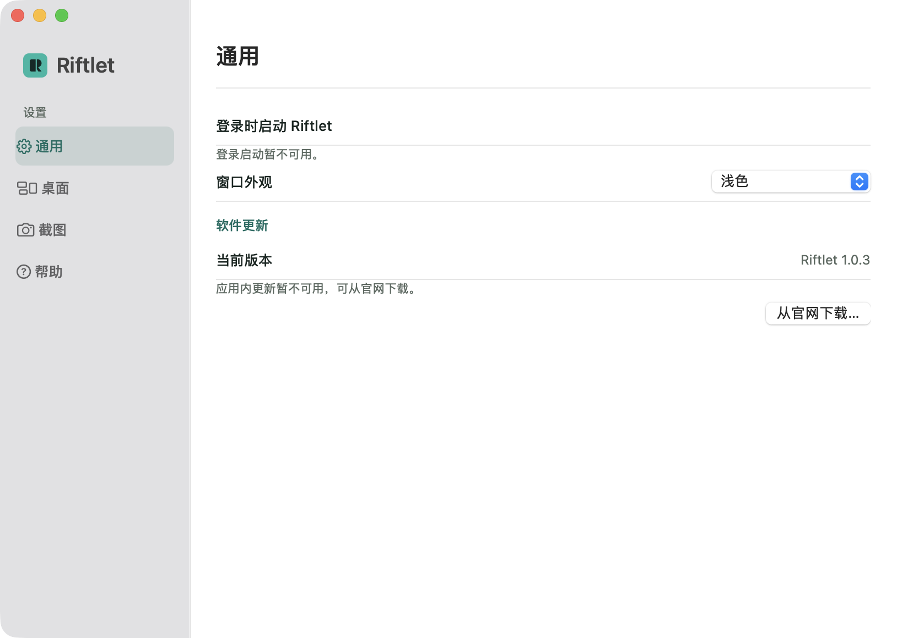

四导航占用宽品牌侧栏；通用内容稀疏、主体明显空。原生自然按钮已实现，不再把PR103之前的拉伸按钮当现存缺陷。最终用紧凑顶部页签，提高有效内容比例；版本/更新成组，平时只出现必要状态。

### 当前桌面页，浅色与深色（真实运行）

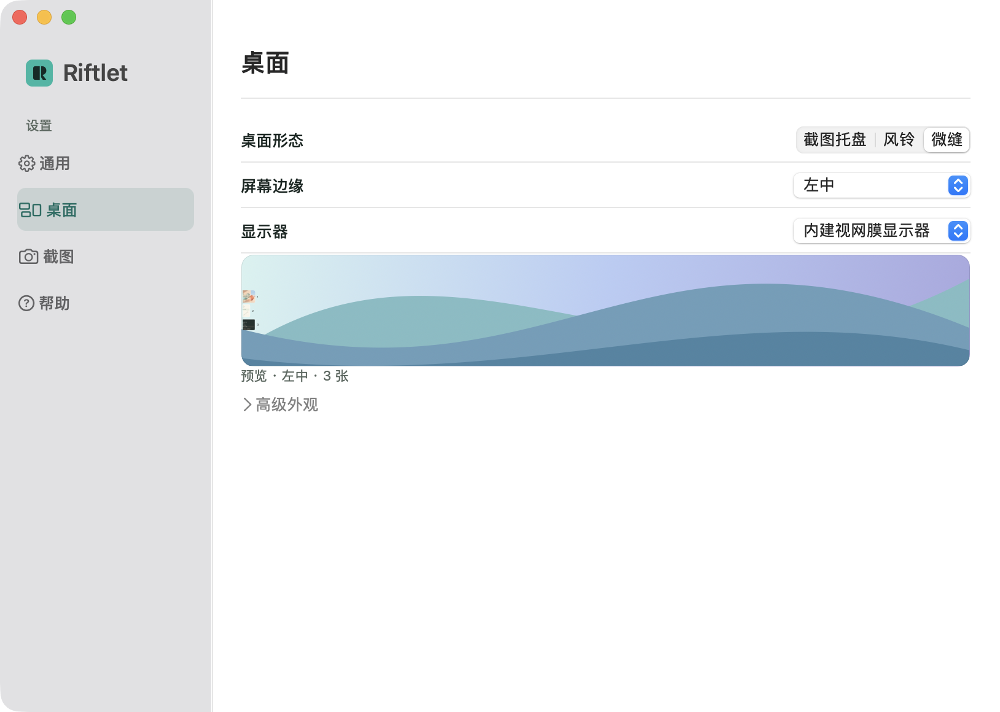

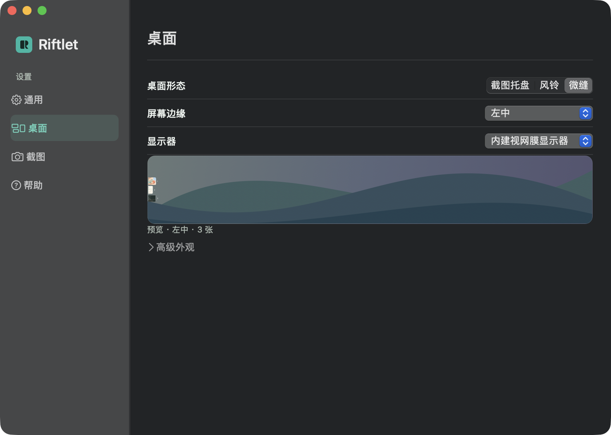

宽而浅的屏幕示意把主体缩得很小，适合表示位置，无法判断相机、玻璃、边框。1.0.4拆成共享真实renderer的约140pt外观样例与紧凑位置图；不把新控件继续塞进这个全桌面缩略图。

### 当前高级选择（真实运行）

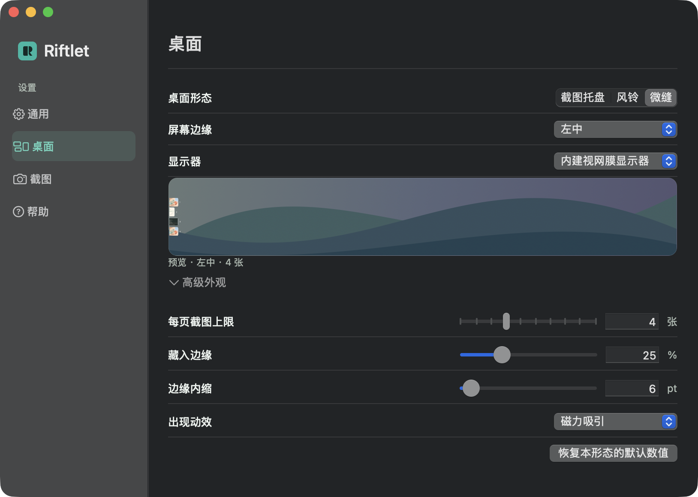

张数、pt、百分比、动效同时呈现，使用目的不在同一层级。1.0.4保留数量/动效在“更多”，旧非默认几何只对既有用户渐进显示；不删其值和恢复能力。未公开截图页经目视确认还包含完整路径、技术用量解释、重检与重复仓库选择；这些分别改为目录末级名、按需存储、帮助诊断和仓库toolbar。

### 1.0.4已裁决结构图——不是运行截图

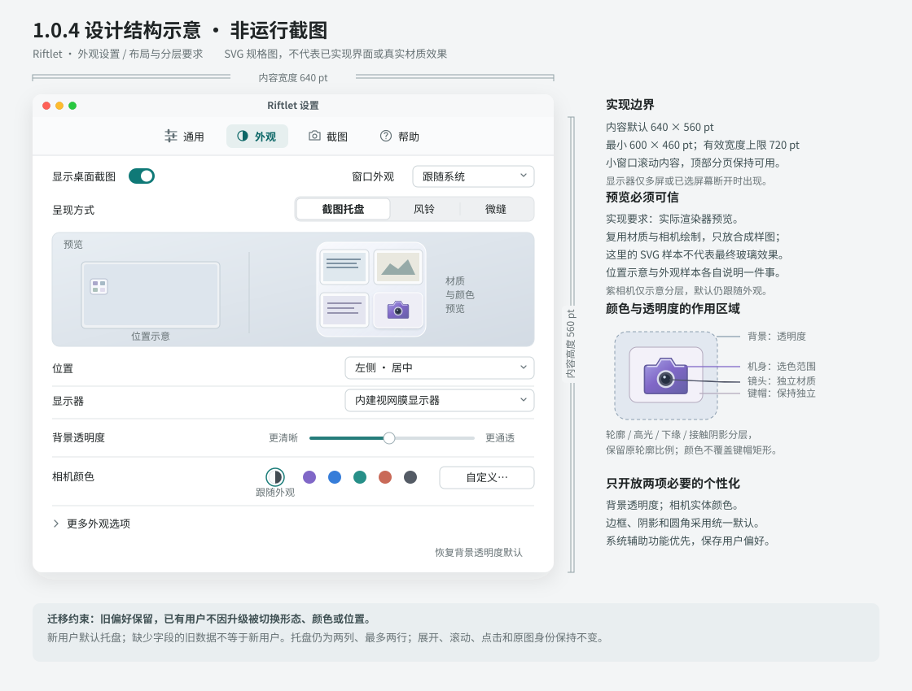

这张SVG是精确关系示意，不声称App已实现。色样/机身示意不代表nil颜色默认改变，字段与颜色规则以[DESIGN_SPEC](DESIGN_SPEC.md)为准。Codex必须用实际1.0.4 AppKit窗口截图替换“已实现”的证据位置，原设计图仍保留设计标签。

## 2. 托盘：保留形态，精修材质

| 真实1.0.3状态 | 原始浮窗图 |
|---|---|
| 无图，主相机键 | 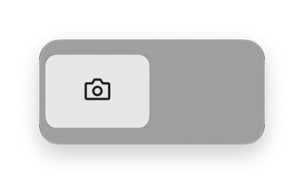 |
| 3张合成宽高比fixture | 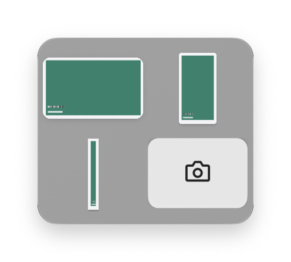 |
| 紫色材质 | 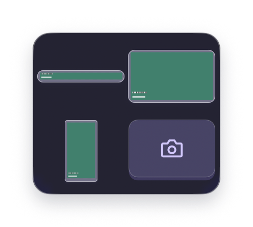 |
| 深色、右侧中部 | 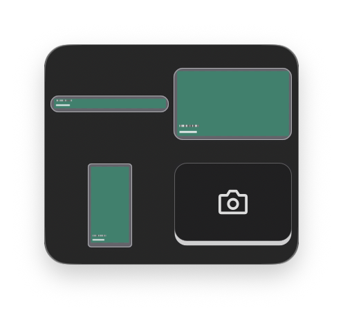 |

双列与已有比例保留。细长缩略图来自刻意构造的宽高比，Fit留白不是缩略图“坏掉”。小相机现为轮廓，体积主要在外键帽；新设计在原相机轮廓内部加克制实体层与独立机身色，键帽和镜头不被整块染色。深色system键帽近白足边较抢眼，需按当前材质推导柔和边缘，与violet保持视觉重量一致。

当前报告的`trayCameraObscured`发生在点击前检查顶层窗口时；不能从这些静态图断言是自身遮挡、外部环境或坐标错误。T03需记录windowID/owner/frames/scale后重跑自然输入，并完成两次展开/逃逸循环；修复前保留FAIL。

## 3. 其他实际界面与跨页一致性

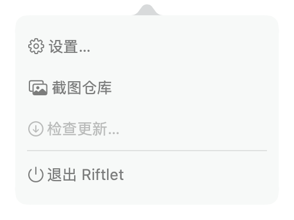

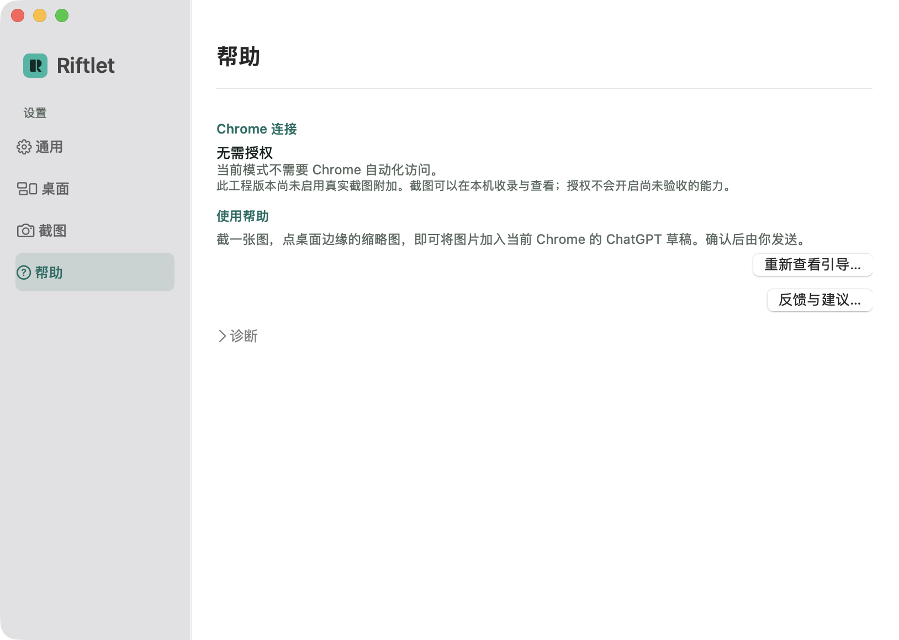

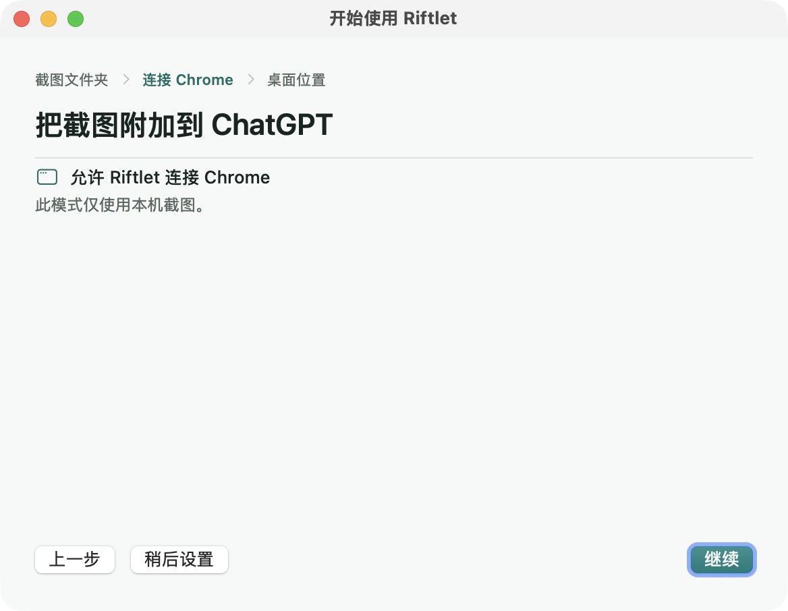

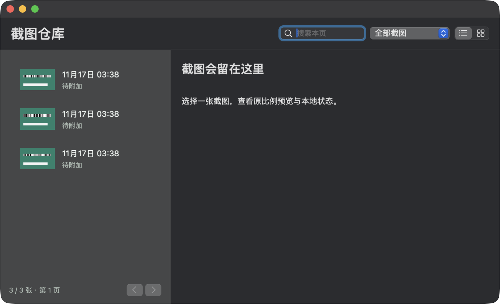

菜单维持四项，不再增加常驻诊断。帮助将多个连接/权限动作收敛成当前唯一下一步；首用取消强制位置决定并统一关闭/稍后。仓库已有真实记录和视图，1.0.4解决超过200条后的全库找回及错误可见性。中文英文、按钮、间距、空/错/禁用态由同一token与文案规则统一。

## 问题→最终方案→实现证据要求

| 现状 | 最终方案 | 1.0.4必须补交 |
|---|---|---|
| 宽侧栏、页面密度差 | 四顶部页，640×560/min600×460，分组间24pt | 四页浅/深/最小/宽窗真实图；中英文、键盘与AX |
| 简化示意不能看材质 | 共享renderer外观样例+单独位置图 | 与真实托盘同参数/同合成素材对照，禁止独立假样式 |
| 透明度固定、整盘tint | 背景t滑杆、实体body色，层次独立 | 默认/极值/五色/黑白mask对照；内容与hit不变 |
| 暗态键帽足边抢眼 | 固定共享材质/边界/阴影token | 相同复杂桌面、1×2×、浅深实拍，不只cutout |
| 首用关闭语义不齐 | close/Cmd-W/Later统一deferred | 普通隔离profile重启实际不再自动弹，已授权保持 |
| 本页查询 | 全库metadata查询先分页后呈现 | 第201/401条、组合查询/恢复/新图锚点真实界面 |

最终验收使用[ACCEPTANCE](ACCEPTANCE.md)；每张图必须标源/包/环境和原始hash，包含首次失败与修复后差异，不用设计稿、旧debug宿主或其他包证明当前候选。
