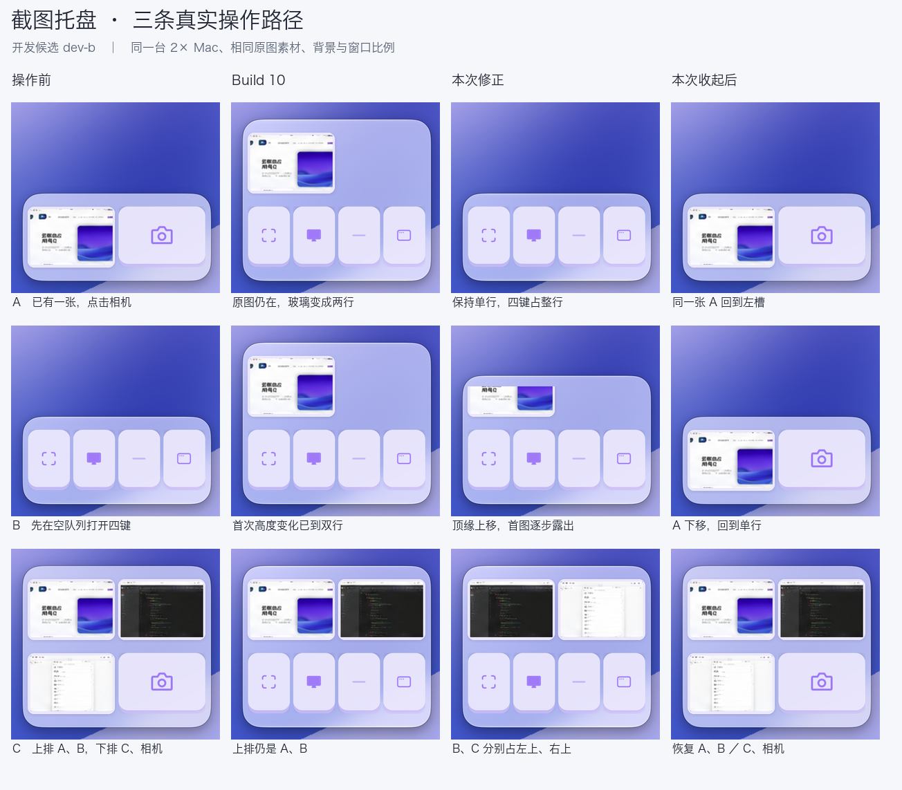
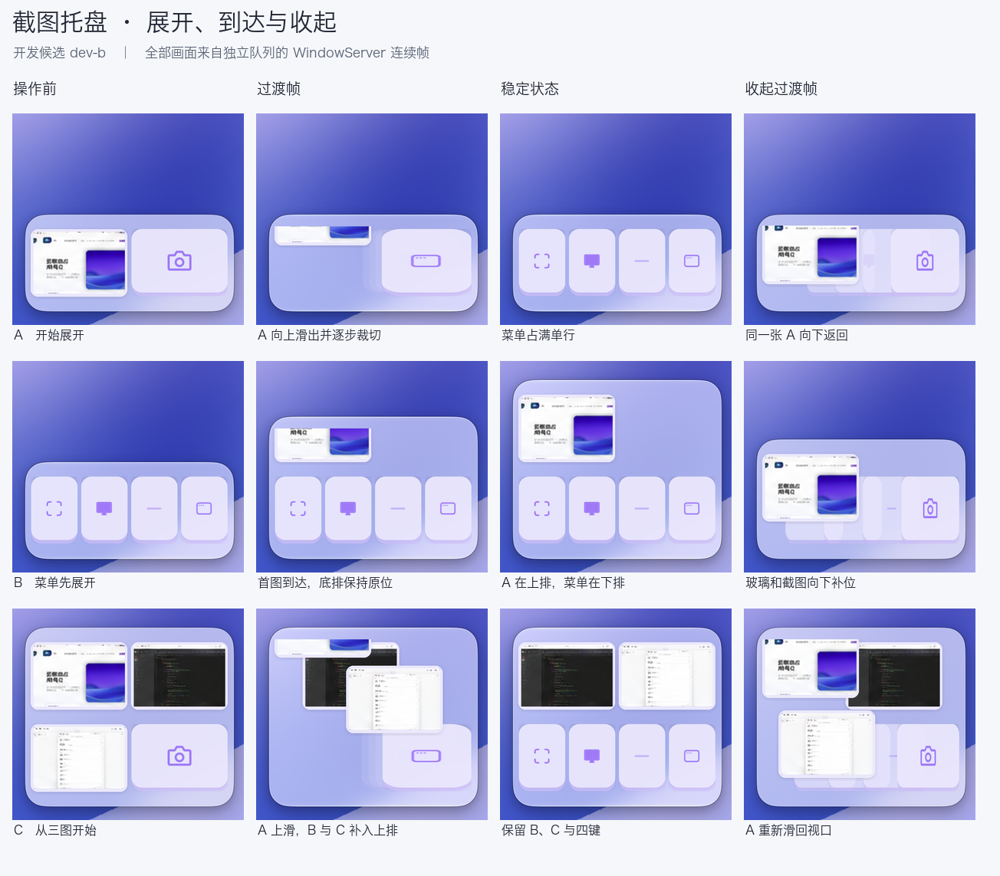

# 截图托盘菜单：展开时已有的图，与展开后到达的图

[修订规格](https://github.com/haohongfei2001-png/Riftlet/blob/90f0ce4139c792e370f3700d5a868c014080e02d/design/third-form-screenshot-tray/README.md) · [阻塞审查及旧包证据](https://github.com/haohongfei2001-png/Riftlet/pull/57#issuecomment-6747191916) · [build 10 原视觉记录](TRAY-REFERENCE-REVIEW.md)

| 操作 | 签名 build 10 实拍 | 修正后：展开 → 收起 |
| --- | --- | --- |
| 已有 A，再开菜单 | 从 132 pt 增高到 244 pt，A 留在上排 | 始终 132 pt；A 向上滑出，四键占原来的一行；同一 A 滑回原槽 |
| 空菜单已打开，再收到 A | 有上下两行，但首个可测增高帧已经是双行高度 | 132 → 244 pt，首图在上方逐渐露出，下排菜单位置不变；A 下移回到单行的「A、相机」 |
| 已有 A、B、C，再开菜单 | 留下 A、B，挤走 C | 始终 244 pt；A 上滑，B、C 补到上排，四键在下；收起还原「A、B／C、相机」 |

高度为同一台 2× Mac 的实测点数。原来的面板宽度、单行与双行高度公式、材质、色值和按键均未变更。A、B、C 是从公开参考素材导入隔离队列的三张不同图片，下面两图是真实 WindowServer 画面。开发构建与最终签名 App 分别记录，不互相代替。

打开相机时记下那一页的 UUID。顶出去的是原截图窗口，临时离开可见范围时撤掉它的点击区域；回到视口时用原 UUID 补位。滚轮从眼前可见的卡片翻页。打开后真正收录的截图单独记录，主动翻页可以查看较早的图；此过程不写回或重排队列。已证实失败而返回的原图仍按原 UUID 可见，既有 UNKNOWN 不会因此恢复。

程序级复核在产品源 `8174c733e77ec3f2cdb169fe86414257581636e1` 对应的五份 Swift 文件上完成：608 项布局断言、384 项 AppKit 窗口断言通过。过程中保留了优先 UUID 去重的六个失败断言；修复后用同一组断言重验。另在开发 App 实拍 212 帧，测量裁切、输入窗、同一 UUID 滑回与分页。单独取退场截图窗口的像素，A/C 与原比例平移模型的平均通道误差最高 0.25/255；画面被裁切时没有被压扁。

最终签名包的独立窗口录像、二进制身份和五项正式 CI 随[同一个 Draft PR 的交付回执](https://github.com/haohongfei2001-png/Riftlet/pull/57)提供。四个位置映射三种真实截图方式，可有空位。build 10 曾有一次初开未展开，之后 12/12 复查成功，原因仍是 **UNEXPLAINED / NOT FULLY VERIFIED**。本专项没有实测 Chrome/ChatGPT 附件，也没有替换个人 Beta。
