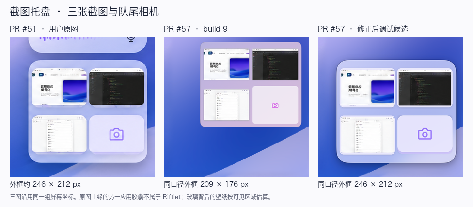
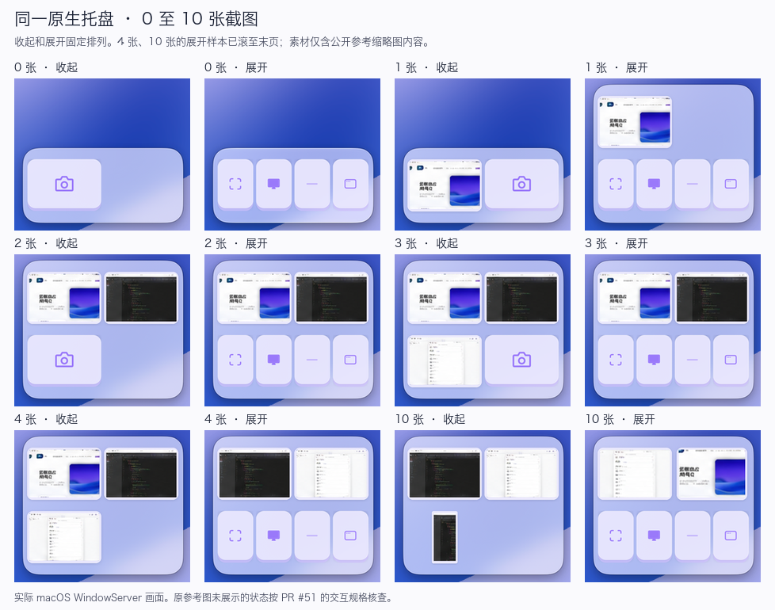

# 截图托盘 · PR #51 原图对照

依据 [PR #57 的阻塞审查](https://github.com/haohongfei2001-png/Riftlet/pull/57#issuecomment-6743756704) 和 [PR #51 中的原始图与完整规范](https://github.com/haohongfei2001-png/Riftlet/tree/051cb1a2d1057cba25f3d756d2499d4564cbe320/design/third-form-screenshot-tray)。原 PNG 为 1672 × 941，SHA-256 为 `65b61d4d7a62e9221b45b8c0c9afff3626b904a242de0d321d9bda5d56887e0b`。

## 尺寸与素材

| 项目 | 参考图像素 | 原生实现 |
| --- | --- | --- |
| 浮板与上方胶囊 | 均约 246 宽，占屏幕宽的 14.7% | 以当前显示器宽度乘以 246/1672，转换为逻辑点后在实际 backing scale 对齐。胶囊仅作标尺。 |
| 双行 | 约 212 高，左右内距约 7、上下约 17–18，行距约 17、列距约 5 | 顶部两格、底部两格，满队列滚动时外框固定。 |
| 单行 | 参考仅展示 3+1 双行 | 单行复用双行图中 80 高的图格和上下留白，参考比例高度为 115。0–1 张收起为单行，0 张展开仍单行，1 张展开时截图上移。 |
| 相机格 | 约 114 × 80，图标约 28 × 24 | 截图入口开启时作为最后一项。默认键在外缘，三个常用键复用真实截图能力。 |
| 位置 | 中心约在整屏中线下方 56，距右缘约 16 | 中央摆位使用完整屏幕的视觉中线，再限制在可用桌面。对照状态显式选择右中与相应边距；个人设置仍决定实际位置。 |

窗口由独立 App 和按 UUID 隔离的数据库生成。用公开参考图的三块缩图内容作为输入，另设极端比例和小图。收录后由正常的缩图缓存、排版和截图控制按钮渲染。桌面夹具保留原图可见的纯壁纸，在胶囊和托盘遮住的区域用相邻壁纸估算；其中没有预绘托盘、胶囊、按钮、阴影或缩图。几何和颜色均以同一画布比较。原图只给出右侧浅色、紫蓝、三张截图加入口的收起态，其余状态按交互规格检查。

## 交互与兼容

- 瞬间切换和开合绑定原截图 UUID。玻璃和截图在同一进度移位，收起后恢复原队列。用户主动翻页可以离开菜单打开时新截图的临时优先展示。
- 通过两个独立尺寸上限等比 Fit，小图按实际屏幕 backing scale 限制到原始像素。卡片边缘属于原生背板。遮挡只缩小实际可见区域及对应命中面。
- 四个位置分别是三个可配置常用键和一个默认键。引擎支持窗口、区域、全屏；没有第四个不同的截图动作。空位禁用，显式指定的顺序、重复选择或留空在重启后保留。
- Build 9 的失败记录、CI、签名和窗口截图属旧源码。当前候选单独审查、签名和验证。真实 Chrome 附加未包括在视觉复验中。

## 实际画面

以上是修正过程中真实调试 App 的 WindowServer 画面。三联图按相同的屏幕坐标、倍率与 sRGB 口径展示。左图直接裁自公开原图；中、右图分别实拍旧、新原生窗口。原图中被托盘遮住的壁纸通过周围像素估算。最终签名包的独立采样和 CI 见 PR 交付回执。

| 实测样本 | 结果 |
| --- | --- |
| 同口径双行外框 | 原图约 246 × 212 px。build 9 约 209 × 176 px。修正后约 246 × 212 px。 |
| 同坐标整块裁切 | 278 × 250 像素，三通道平均绝对误差从 build 9 的 76.06 降至 8.27/255。新外框的左边、上边、宽、高分别相差 −0.12、−0.76、+0.45、+0.48 个参考像素。 |
| 参考对应的裸玻璃 | 5,783 个同位置样本；sRGB 8 bit 红、绿、蓝通道平均绝对误差分别为 4.57、3.92、3.49，95 分位为 12、10、9。 |
| 相机键面 | 2,010 个样本，逐通道平均绝对误差为 0.73、0.61、0.85。 |
| 图标、圆角 | 相机实拍墨迹约 28 × 24，参考约 29 × 26 像素。圆角的估算取决于半透明边界的阈值，参考约 25–32，实拍约 25–26 像素。 |
| 偏差 | 左壁个别采样点仍亮约 +16、+12、+4。沿下方斜线的实际壁纸受遮挡；其估算位置、系统玻璃折射和窗口投影会影响逐像素误差。缩图保留完整矩形图像，底卡圆角不能完全复制参考截图自带的窗边。 |

macOS 26 及以上配套 SDK 使用系统 clear glass。较早运行时和 SDK 使用 behind-window NSVisualEffectView。Retina 与 1× 的光栅化、系统材质和壁纸会产生差别。用户视觉裁决在 PR 保持 Draft 期间进行。

## 原生交互复验

- 连续两次展开后，旧版本把实际事件窗口错误地判为失焦，第二次 Escape 未收起。修正后，在 0、1、2、3、4、10 张截图的状态下，受控 macOS 鼠标与键盘事件都能重复打开和关闭菜单。
- 收起时，旧版本的窗口在缩图移动中跳到最终高度。修复后 15 帧 WindowServer 采样中，外框高依次为 244、211、183、163、150、141、136、133、132 点，原截图的同一视觉窗口与命中窗口随外框补位。
- 菜单展开时实际收录第三张图片，最上行出现新图和原第一张，菜单保持整行。Escape 后新图回到第三槽，截图 UUID 和命中窗身份保持，数据库中三条记录可见、附件操作数为零。
- 1× 独立 macOS 使用真实 AppKit 窗口生成左右两侧、浅深两色与 6 种张数的开合画面，共 48 帧。每帧验证窗口身份、可见内容与壁纸差异。2× 宿主另以系统鼠标、键盘及滚轮事件驱动交互。
