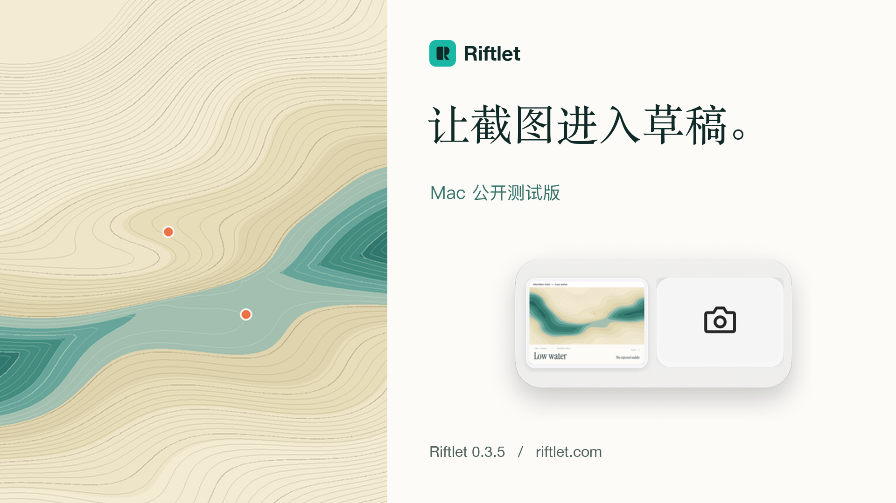

# Riftlet · 第一轮 Launch Kit

**把这一处，带进草稿。** 两张同一海湾的潮汐图，一次关于岸线的问题。主片展示 Mac 保存的窗口截图怎样来到 Riftlet 托盘，以及用户怎样认出要选的那一张。

**先看 40 秒主片**　[中文版 MP4](video/master/riftlet-zh-CN.mp4) · [English MP4](video/master/riftlet-en-US.mp4)　｜　[画面核验与限制](evidence/quality.md) · [官网下载](https://riftlet.com/)

## 视频

| 影片 | 时长与画幅 | 简体中文 | English |
| --- | --- | --- | --- |
| 把这一处，带进草稿 · 主宣传片 | 40 秒，1920 × 1080 | [播放](video/master/riftlet-zh-CN.mp4) | [Play](video/master/riftlet-en-US.mp4) |
| 刚截的图在哪里 · 凭图选择 | 18 秒，1080 × 1920 | [播放](video/shorts/01-by-sight-zh-CN.mp4) | [Play](video/shorts/01-by-sight-en-US.mp4) |
| 相机键里有什么 · 托盘近景 | 19 秒，1080 × 1920 | [播放](video/shorts/02-tray-controls-zh-CN.mp4) | [Play](video/shorts/02-tray-controls-en-US.mp4) |
| 两个潮位 · 连续收录 | 20 秒，1080 × 1920 | [播放](video/shorts/03-two-tides-zh-CN.mp4) | [Play](video/shorts/03-two-tides-en-US.mp4) |

全部为 H.264、30 fps，附原创 AAC 音轨，静音状态下也可阅读。GitHub 文件页可使用 **Download raw file** 下载到 Mac，用 QuickTime Player 打开。GIF 和 PNG 文件可直接点开预览。在本地可用 Finder 快速查看这些文件。

## 动图、产品图与封面

| 媒体 | 可直接预览的文件 |
| --- | --- |
| GIF · 768 × 570 | [第一张截图进入托盘](gif/01-arrival.gif) · [展开与收起截图方式](gif/02-tray-menu.gif) · [右侧微图的原生按压](gif/03-thumbnail-press.gif) · [两张系统截图连续收录](gif/04-two-captures.gif) |
| 产品图 | [整体展示](images/01-overview.png) · [托盘近景](images/02-tray-detail.png) · [三步操作](images/03-workflow.png) · [实际取景样张](images/04-two-tides.png) · [相机键细节](images/05-camera-control.png) · [品牌主视觉](images/06-brand.png) |
| 封面 | [产品发布，1920 × 1080](covers/01-public-beta.png) · [竖屏社交视频，1080 × 1920](covers/02-social-video.png) · [官网或活动分享，1600 × 840](covers/03-site-campaign.png) |

## 平台稿

[中文、英文文案索引](copy/README.md) 含 Product Hunt、Reddit、X、小红书和 Bilibili 的十份稿件，按平台提供标题、正文、媒体配文、下载引导及常见问题。外发稿的下载入口统一为 [riftlet.com](https://riftlet.com/)。实际发布前请核对首页下载仍指向届时的公开版本。

## 哪些动作拍到了

拍摄基准为 **Riftlet 0.3.5（20）Public Beta**。两次真实 macOS 窗口截图经正式 App 的收录器进入隔离队列。微图、托盘展开和第二张微图的辅助功能按压都来自原生窗口录像。Mac 图形会话、版本指纹、原图与副本逐张比对和帧索引已留档。[拍摄记录](video/capture-log.md) · [原生取证](evidence/native-capture.json)

真实 ChatGPT 网页的双图验收发生在 **build 18**。本次 build 20 隔离环境关闭网页输入；首图和第二图进入真实草稿均为 **NOT_RUN**。影片用独立文字镜位介绍这个目标，保留在桌面拍到的操作。所有取景素材均来自原创演示图；此次拍摄未发送消息。[支持矩阵](../../docs/consumer/SUPPORT-MATRIX.md) · [公开发行说明](https://github.com/haohongfei2001-png/Riftlet/releases/tag/v0.3.5-beta.1)

## 策略、片源与验收

- [产品事实](strategy/product-truth.md) · [推广定位](strategy/positioning.md) · [功能核验](strategy/feature-verification.md) · [视觉与创意方向](strategy/creative-direction.md)
- [主片分镜](video/storyboard.md) · [可编辑剪辑与绘图工程](video/project/README.md) · [素材来源与使用说明](source/README.md)
- [24 秒无损实录](source/edit/tray-lossless.mp4) · [低潮窗口原像素](source/edit/low-window.png) · [高潮窗口原像素](source/edit/high-window.png)
- [发行及下载核验](evidence/release.md) · [质量审阅](evidence/quality.md) · [最终 21 个媒体文件的校验回执](evidence/media-qa.json)

工作树另保留原始 MOV、带原生标记的系统截图及录制采样。此仓库未给这些文件配置 Git LFS；入库的 24 秒剪辑片源约 1.9 MiB，与本地无损原录全部 720 帧的 RGB 完全相同。
