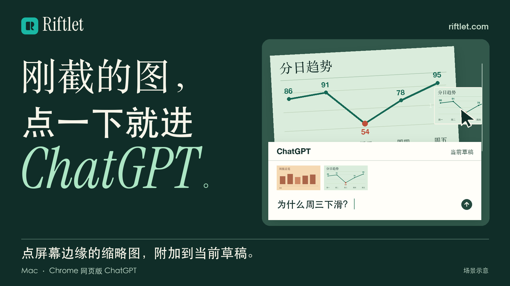

# Riftlet · 刚截的图，点一下就进 ChatGPT。

一个人正问「为什么周三下滑？」，草稿里已经有一张周报总览。他用 Mac 系统截下趋势图，点一下屏幕边缘刚出现的小图。趋势图加在原附件旁边，他接着写「和上周比呢？」。

[中文首屏预览](web/index.html) · [English homepage preview](web/en.html) · [官网提案的高清预览及交互说明](web/PREVIEW.md)

## 播放与下载

| | 中文 | English |
|---|---|---|
| 横版主片 · 20 秒 · 1920 × 1080 | [播放](film/zh-CN/master.mp4) · [字幕](film/zh-CN/captions.srt) | [Play](film/en/master.mp4) · [Captions](film/en/captions.srt) |
| 竖版短片 · 15 秒 · 1080 × 1920 | [播放](film/zh-CN/vertical.mp4) · [字幕](film/zh-CN/vertical.srt) | [Play](film/en/vertical.mp4) · [Captions](film/en/vertical.srt) |
| 从成片选取的高清缩略图 | [横屏](film/zh-CN/thumbnail.jpg) · [竖屏](film/zh-CN/vertical-thumbnail.png) | [Landscape](film/en/thumbnail.jpg) · [Portrait](film/en/vertical-thumbnail.png) |
| 独立设计的视频封面 · 1920 × 1080 | [B 站中文封面](social/covers/zh-CN.jpg) | [English video cover](social/covers/en.jpg) |
| 链接分享封面 · 1200 × 630 | [中文](social/share/zh-CN.jpg) | [English](social/share/en.jpg) |

## 小红书

第一张竖图也可直接作为中文小红书封面。五张依次为[为什么值得用](social/xiaohongshu/01-claim.jpg)、[照常截屏](social/xiaohongshu/02-capture.jpg)、[点哪一张](social/xiaohongshu/03-click.jpg)、[回到原草稿](social/xiaohongshu/04-draft.jpg)、[托盘和微缝怎样补位](social/xiaohongshu/05-appearances.jpg)。每张 1440 × 1920。[配套标题和正文](social/NOTE.md)

## 制作与验收

- [传播母稿](MESSAGE.md)及[制作前分镜审查](review/story-review.md)说明为何在前五秒就要看到用户点哪一张图。
- [来源与取景记录](review/sources.md)、[外观几何依据](review/appearances-sources.md)及[发行功能核验](review/release-evidence.md)区分素材出处和证据范围。核心桌面与 Chrome 草稿为真实感合成，周报为虚构示例。公开版 1.0.5（31）支持 Mac 上的 Google Chrome 网页版 ChatGPT。
- [横版与竖版重建](studio/README.md)、[原始图表](capture-props/chart.html)、[音乐母带](film/score.wav)、[社交图文工程](social/README.md)、[封面工程](social/COVERS.md)、[首屏工程](web/PREVIEW.md)。
- [验收报告](review/QA.md)、[首次观看记录](review/first-view.md)、[技术检测与 SHA-256](review/technical.json)。
