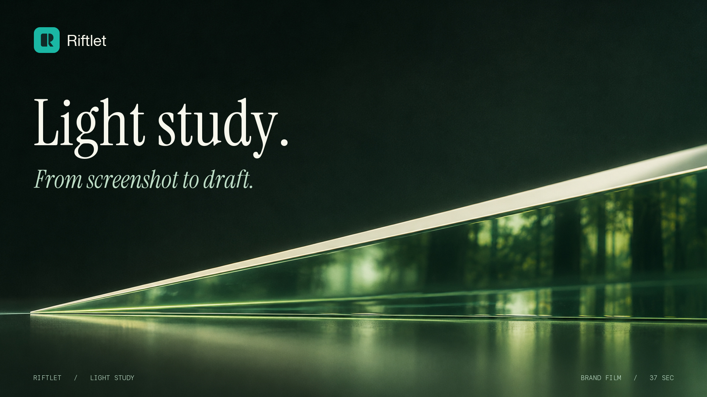

# 光的路径 · Light study

两道光在桌面上交汇。设计者想问它们在哪里相交，于是截下那个细节。影片跟随同一张图从取景框来到 Riftlet 托盘，再进入写着这个问题的草稿。

| 影片 | 规格 | 内容 |
|---|---|---|
| [Brand Film · 光的路径](films/brand-film.mp4) | 37 秒 · 1920 × 1080 · 24 fps · 原创配乐 | 两张光学图版，真实托盘比例，草稿内附加的设计动画。[中文字幕](captions/brand-film.zh-CN.srt) · [English captions](captions/brand-film.en.srt) |
| [Product Demo · 两次潮汐](films/product-demo-native-excerpt.mp4) | 24 秒 · 1920 × 1080 · 30 fps · 无声 | 公开 build 20 在隔离桌面实际运行。两次系统截图收录，原生菜单，以及测试向缩略图发出输入后的桌面状态。[中文字幕](captions/product-demo.zh-CN.srt) · [English captions](captions/product-demo.en.srt) |
| [Capture · 看见交点](films/short-capture.mp4) | 8 秒 · 1080 × 1920 | 为竖屏重新构图，从光线交点切入截图。 |
| [At hand · 两个角度](films/short-at-hand.mp4) | 8 秒 · 1080 × 1080 | 托盘从一排展开为两排，两个角度并排供选择。 |
| [Draft · 放进问题里](films/short-draft.mp4) | 8.5 秒 · 1080 × 1350 | 点选其中一张，已有问题和另一张待用缩略图都保留。 |

本次检查到的最新公开发行是 **0.3.5（20）Public Beta**，支持 macOS 13 及以上，网页附加目标为 Google Chrome 前台可编辑的 ChatGPT 草稿。Product Demo 的实录止于本机托盘，当次产生 0 个附加操作。已公开记录的两张图片连续进入同一真实草稿的验证来自 build 18。 [发行说明](https://github.com/haohongfei2001-png/Riftlet/releases/tag/v0.3.5-beta.1) · [支持矩阵](../../../docs/consumer/SUPPORT-MATRIX.md)

## 动图与平面

| 组别 | 文件 |
|---|---|
| 4 个 GIF | [取景](loops/01-select.gif) · [收录](loops/02-arrive.gif) · [双图](loops/03-pair.gif) · [点选附加](loops/04-attach.gif) |
| 6 张展示图，2400 × 1350 | [光学研究](stills/01-observation.jpg) · [截取交点](stills/02-capture.jpg) · [第一张微图](stills/03-arrival.jpg) · [双图托盘](stills/04-tray.jpg) · [继续写草稿](stills/05-draft.jpg) · [公开版](stills/06-edition.jpg) |
| 3 张封面 | [英文媒体横版](covers/press-16x9.jpg) · [社交竖版](covers/social-4x5.jpg) · [Bilibili 中文横版](covers/bilibili-16x9.jpg) |

## 文案与制作文件

[中英文文案与平台配图表](copy/README.md) 包含 Product Hunt、Reddit、X、小红书、Bilibili 以及媒体介绍。各平台文件另提供本地可直接取用的标题、正文、配文及图像描述。

[创意和逐镜分镜](studio/direction.md) · [摄影底片与生成提示词](originals/README.md) · [视频、声轨、动态图形和平面工程](studio/README.md) · [实录母片及时间线](native-demo/README.md) · [质量验收](review/README.md)
